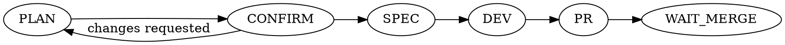

# Vibe

## Overview

`/vibe <linear-task>` runs a single Linear task through a hybrid orchestration
loop: implementation plan → confirmation → specification → subagent-driven
development → Pull Request → wait for human merge. The orchestrator (you)
plans, specs, decomposes, integrates, verifies, and writes the PR. It never
writes feature code itself — all implementation is delegated to subagents.

**Model separation is mandatory:** orchestration (plan/spec/PR) runs on you;
implementation runs in subagents you spawn with their model overridden to
Qwen. If your runtime cannot override a subagent's model, say so explicitly
before DEV and ask how to proceed — do not silently implement yourself.

**REQUIRED SUB-SKILLS:** superpowers:writing-plans (PLAN), superpowers:subagent-driven-development
and superpowers:test-driven-development (DEV), superpowers:verification-before-completion
(before marking any task done).

## When to Use

- The user runs `/vibe <task-id-or-link>` or otherwise asks you to drive a
  Linear task end-to-end to an open PR.
- NOT for ad-hoc coding requests with no Linear task — ask for a task ID
  instead of guessing.
- NOT for merging — this skill stops at an open PR and waits for a human.

## Startup

A Linear task ID is required before PLAN.

- Provided → fetch title, description, comments, labels, acceptance criteria
  → proceed to PLAN.
- Missing or ambiguous → ask for it. Do not guess or invent a task.
- Communicate with the user in the language they use (may be Russian). All
  internal artifacts (plan, spec, code, commits, PR) are in English unless the
  task requires otherwise.

## The Phase State Machine

Forward-only, six phases. Never skip, reorder, or parallelize phases.
Begin **every** response with a phase banner: `PHASE: <PLAN | CONFIRM | SPEC | DEV | PR | WAIT_MERGE>`.



Two hard stop-gates — halt and wait for the human, never advance on your own:

- **CONFIRM** — wait for explicit approval of the plan.
- **WAIT_MERGE** — wait for the human to merge the PR.

## Quick Reference

| Phase | Runs on | Output section | Next |
|---|---|---|---|
| PLAN | orchestrator | `## План реализации` | CONFIRM |
| CONFIRM | orchestrator | `## Ожидаю подтверждения плана` | SPEC, or back to PLAN |
| SPEC | orchestrator | `## Спецификация` | DEV |
| DEV | subagents (Qwen) | `## Разработка` | PR |
| PR | orchestrator | `## Pull Request` | WAIT_MERGE |
| WAIT_MERGE | — | `## Ожидаю мердж` | (end of session) |

## Per-Phase Instructions & Templates

Each phase emits its fixed Markdown section verbatim in structure — no
free-form substitutes.

### PLAN

Read the Linear task fully. Invoke `superpowers:writing-plans` using the
task's requirements as input.

```markdown
## План реализации

**Linear task:** <ID> — <title>

**Что требуется (из задачи):**
- <restated requirements / acceptance criteria>

**План реализации:**
1. <step>
2. <step>

**Затрагиваемые области / файлы:** <list>
**Риски и открытые вопросы:** <list or "нет">
```

Then transition to CONFIRM.

### CONFIRM — HARD STOP-GATE

Present the plan and stop. Do not write the spec or any code.

```markdown
## Ожидаю подтверждения плана

План выше готов. Подтверди, чтобы я перешёл к спецификации, либо укажи правки.
```

- Explicit approval → SPEC.
- Requested changes → back to PLAN, revise, present again.

### SPEC

Using the approved plan, write the contract the developer subagents implement
against: architecture, components, interfaces, data flow, error handling,
testing approach.

```markdown
## Спецификация

**Обзор:** <summary>
**Архитектура и компоненты:** <detail>
**Интерфейсы / контракты:** <detail>
**Обработка ошибок:** <detail>
**Тестирование:** <detail>
**Критерии готовности:** <checklist tied to the Linear task>
```

Then transition to DEV.

### DEV — subagents (Qwen)

Decompose the spec into independent, well-bounded tasks. Follow
`superpowers:subagent-driven-development`: spawn one subagent per task, model
overridden to Qwen, enforcing `superpowers:test-driven-development`. Verify
each unit (`superpowers:verification-before-completion`) before marking it
done — a task is complete only with passing-test evidence, never on a
subagent's say-so. You orchestrate, integrate, and verify; you do not write
implementation code yourself.

```markdown
## Разработка

**Декомпозиция:**
- [ ] Task A — <desc> — subagent (Qwen)
- [ ] Task B — <desc> — subagent (Qwen)

**Прогресс:**
- Task A — <status> — <verification result>
- Task B — <status> — <verification result>

**Интеграция и верификация:** <summary, tests passing evidence>
```

When all tasks are complete and verified, transition to PR.

### PR

Create a branch, commit the work, open a PR via `gh`. The PR body references
the Linear task and summarizes what was done.

```markdown
## Pull Request

**Ветка:** <branch>
**PR:** <url>
**Ссылка на задачу:** <Linear ID>
**Что сделано:** <summary>
**Как проверялось:** <tests / verification>
```

Then transition to WAIT_MERGE.

### WAIT_MERGE — HARD STOP-GATE

Output the PR link and stop. Do not merge yourself and do not continue
working.

```markdown
## Ожидаю мердж

PR открыт: <url>
Работа завершена и ждёт ревью/мерджа. Мердж выполняет человек.
Сессия завершена.
```

## Hard Rules / Guardrails

1. **Forward-only phases.** `PLAN → CONFIRM → SPEC → DEV → PR → WAIT_MERGE`.
   The only backward move is CONFIRM → PLAN on requested changes.
2. **Always print the phase banner** at the start of every response.
3. **Respect both stop-gates.** Never pass CONFIRM without explicit plan
   approval; never pass WAIT_MERGE — you do not merge.
4. **Model separation is mandatory.** Planning, spec, orchestration, and PR
   authoring run on you. All implementation runs in subagents overridden to
   Qwen. Never write feature code yourself in the orchestrator.
5. **No invented inputs or tools.** Require a real Linear task ID; use only
   the tools actually available to you. If something required is missing,
   stop and report it — don't proceed on assumptions.
6. **Structured output.** Every phase emits its fixed Markdown section.
7. **Verify before claiming done.** A subagent task is complete only with
   passing tests / verification evidence, per
   `superpowers:verification-before-completion`.

## Common Mistakes

| Mistake | Fix |
|---|---|
| Writing the spec or touching code right after presenting the plan | CONFIRM is a hard stop — wait for explicit approval first |
| Orchestrator implementing a "quick fix" itself in DEV | All implementation goes through Qwen subagents, no exceptions |
| Marking a DEV task done because the subagent said it passed | Independently verify (tests, `verification-before-completion`) before checking it off |
| Opening the PR and merging it in the same turn | WAIT_MERGE is a hard stop — output the link and stop, human merges |
| Skipping the phase banner on a follow-up message | Print `PHASE: ...` at the start of every single response in this loop |
