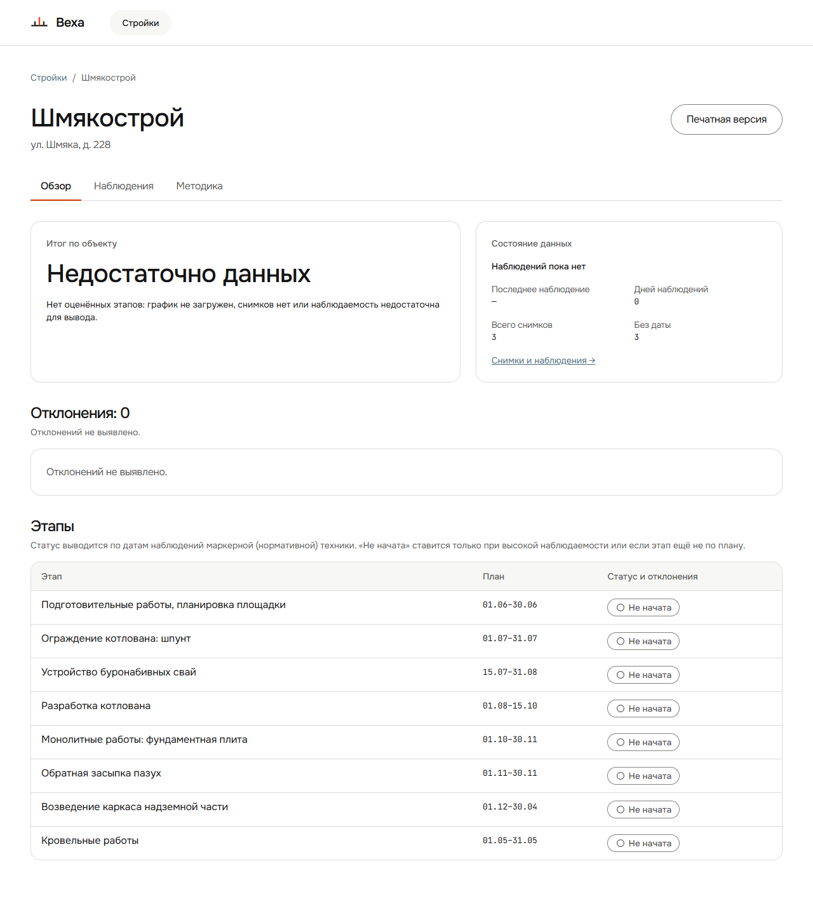

# 002 — Обзор: прошедшие этапы без данных показаны как «Не начата»

- **Тип:** логика (фронт + бэк)
- **Экран:** Стройка → Обзор, таблица «Этапы» и карточка «Итог по объекту»
- **Серьёзность:** высокая — экран утверждает о стройке то, чего система не знает
- **Статус:** открыт
- **Где видно:** стенд http://81.26.184.6, стройка «Шмякострой», версия `sha-b5b34b6`

## Что видно



У стройки загружен график из 8 этапов, есть 3 снимка, но нет ни одного наблюдения: у всех снимков нет даты. На 27.09.2026:

- этапы 1–4 (планы 01.06–30.06, 01.07–31.07, 15.07–31.08, 01.08–15.10.2026) уже должны были начаться, а у них бейдж **«Не начата»**;
- подпись над таблицей тут же говорит: «“Не начата” ставится только при высокой наблюдаемости или если этап ещё не по плану». Наблюдаемость нулевая, окна этапов наступили, то есть экран противоречит сам себе;
- по методике (`docs/architecture.md` §7.1) при отсутствии кадров статус должен быть **«Не наблюдалось»**: «“не начат” — утверждение о стройке, “не наблюдалось” — о наших данных. Смешивать их нельзя»;
- пояснение в карточке «Итог по объекту»: «график не загружен, снимков нет или наблюдаемость недостаточна». Рядом график загружен и 3 снимка есть. Пояснение перечисляет все причины сразу, вместо того чтобы назвать настоящую.

## Как воспроизвести

1. Создать стройку, загрузить график с этапами, у которых плановое начало уже прошло.
2. Не загружать снимки или загрузить только снимки без даты.
3. Открыть «Обзор».

**Ожидается:** у этапов с наступившим окном — «Не наблюдалось»; итог называет причину: «Нет наблюдений: у 3 снимков не задана дата».
**Фактически:** у всех этапов «Не начата», итог — общий текст с тремя причинами.

## Причина

Проблема в двух местах.

1. **Бэкенд не считает статусы, пока нет наблюдений.** `GET /api/sites/{id}/assessment/stages` отдаёт для всех этапов `status: null, computed_at: null`: строк в `stage_status` нет, см. `backend/app/domains/assessment/service.py:79-88`. Этап с наступившим окном и нулём кадров по §7.1 должен получать `not_observed`.
2. **Фронт трактует `null` как «окно ещё не наступило».** `frontend/src/components/ui/StatusBadge.tsx:18-20`:
   ```ts
   /** `status = null` — сервер ещё не оценивал этап: его плановое окно не наступило. */
   const s = STATUS[status ?? 'not_due']   // → «Не начата»
   ```
   Допущение неверно: `null` приходит и тогда, когда пересчёта не было вообще.

Текст итога лежит в `frontend/src/features/overview/SummaryCards.tsx:15-16`: одна строка на весь `insufficient_data`.

## Как исправить (предложение)

1. **Бэк:** пересчитывать статусы этапов при загрузке или замене графика и при правке методики, а не только при появлении наблюдений. Этапы с наступившим окном и без кадров → `not_observed`.
2. **Фронт, страховка:** `status === null` и `planned_start <= сегодня` → показывать «Не наблюдалось» (или нейтральное «Не оценён»), но не «Не начата».
3. **Итог:** выбирать пояснение по фактическому состоянию: нет графика / нет снимков / снимки есть, но без даты (со ссылкой на «Без даты») / наблюдаемость низкая.

## Попутно

Под заголовком «Отклонения: 0» фраза «Отклонений не выявлено.» стоит дважды: в описании секции (`frontend/src/pages/SiteOverviewPage.tsx:22`) и в пустой карточке (`frontend/src/features/deviations/DeviationList.tsx:21`). Одну из них стоит убрать.

## Проверка после фикса

- Стройка без датированных снимков: этапы 1–4 — «Не наблюдалось», этапы 5–8 — «Не начата» (окно не наступило).
- Итог объясняет, что снимки без даты, и ведёт в секцию «Без даты».
- После того как дата задана хотя бы одному снимку, статусы пересчитываются.
