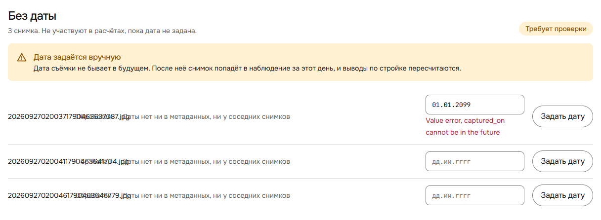
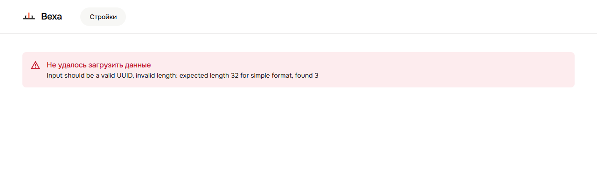

# 003 — Сырые английские ошибки бэкенда в интерфейсе

- **Тип:** UI / обработка ошибок
- **Экраны:** Наблюдения → «Без даты»; любая страница стройки с кривым id в URL
- **Серьёзность:** средняя — на показе выглядит как падение, пользователь не понимает, что делать
- **Статус:** открыт
- **Где видно:** стенд http://81.26.184.6, версия `sha-b5b34b6`

## Что видно

### Будущая дата съёмки

В поле даты ввести `01.01.2099` и нажать «Задать дату». Под полем появится **«Value error, captured_on cannot be in the future»**.

Выше, в плашке, написано «Дата съёмки не бывает в будущем», но форма это не проверяет. Запрос уходит на сервер (`PATCH …/photos/{id}/date` → 422), и пользователь получает текст pydantic.

### Некорректный id стройки

Открыть http://81.26.184.6/sites/abc. На экране: **«Не удалось загрузить данные. Input should be a valid UUID, invalid length: expected length 32 for simple format, found 3»**.

Для сравнения: несуществующий, но корректный UUID (`/sites/00000000-0000-0000-0000-000000000000`) даёт нормальное «Стройка не найдена». Правда, и там нет ссылки назад к списку строек.

## Причина

- `frontend/src/api/client.ts:38-45` (`errorMessage`): при ответе 422 берёт `detail[0].msg` и показывает его как есть. Pydantic пишет эти сообщения по-английски и для разработчика.
- Бэкенд отклоняет будущую дату в схеме (`backend/app/domains/photo/schemas.py:68-74`, английский текст) раньше, чем доходит до русской проверки в сервисе (`backend/app/domains/photo/service.py:550-551`, «Дата не может быть в будущем»). Сервисная проверка до пользователя не доходит.
- `frontend/src/features/observations/NeedsReviewSection.tsx:19-24`: проверяется только формат, а дату из будущего форма не ловит.
- id стройки из URL уходит в API без проверки формата.

## Как исправить (предложение)

1. **Форма даты:** проверять дату локально до запроса («Дата не может быть позже сегодняшней») и заодно поставить `max` / подсказку.
2. **Бэк:** в `reject_future_date` писать русский текст или убрать проверку из схемы и оставить сервисную.
3. **`errorMessage`:** на 422 не показывать `msg` от pydantic, а выводить общее «Проверьте введённые данные». Сырое сообщение писать только в `console` / `detail`.
4. **Роутинг:** если `siteId` не UUID — показывать «Стройка не найдена» без запроса. В оба состояния ошибки добавить кнопку «К стройкам».

## Проверка после фикса

- `01.01.2099` → русская ошибка до отправки, в Network нет PATCH.
- `/sites/abc` → «Стройка не найдена» и ссылка к списку.
- Во всём UI не встречается текст из pydantic (`Value error`, `Input should be`).
