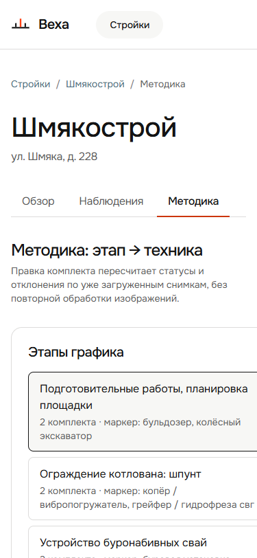
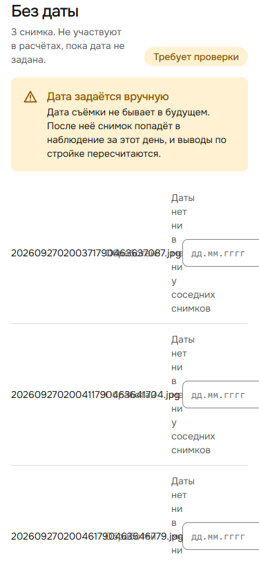

# 004 — На телефоне страницы уезжают вбок

- **Тип:** UI / адаптив
- **Экраны:** все страницы стройки; хуже всего «Методика» и «Наблюдения»
- **Серьёзность:** низкая, если показываем только с ноутбука; средняя, если жюри откроет ссылку с телефона
- **Статус:** открыт
- **Где видно:** стенд http://81.26.184.6, версия `sha-b5b34b6`, ширина окна 375 px (iPhone)

## Что видно

| Методика | Наблюдения → «Без даты» |
|---|---|
|  |  |

Ширина документа при окне 375 px (`document.documentElement.scrollWidth`):

| Страница | Ширина | Что вылезает |
|---|---|---|
| `/sites/{id}/methodology` | **993 px** | список этапов шириной 400 px и редактор комплекта справа от него |
| `/sites/{id}/observations` | **603 px** | строки «Без даты»: поле даты и кнопка «Задать дату» за краем экрана, подсказка сжата до слова на строку |
| `/sites/{id}` (Обзор) | 381 px | таблица этапов: колонка «Статус» уходит до 522 px |
| `/sites` | 411 px | таблица строек |

Страница прокручивается по горизонтали. В «Методике» редактор комплекта целиком за краем экрана, и без прокрутки вбок его не найти.

## Причина

Адаптива почти нет: единственный `@media` на весь фронт — `frontend/src/components/layout/AppLayout.module.css:78`, и он меняет только отступы. Причины по экранам:

- `frontend/src/features/methodology/Methodology.module.css:1-10`: `.layout` — flex в строку, `.aside` жёстко 400 px и `flex: none`. Строки комплекта — сетка `190px 1fr 130px 100px 44px` (`:63`).
- `frontend/src/features/observations/Observations.module.css:78-80`: сетка строки «Без даты» `120px 80px 1fr 200px auto` (см. [001](001-no-date-row-overlap.md)).
- Таблица этапов на «Обзоре» и таблица строек: фиксированные колонки без обёртки с `overflow-x: auto`.

## Как исправить (предложение)

1. Методика: при `width <= 720px` переводить `.layout` в `flex-direction: column`, `.aside` — `width: 100%`. Строку комплекта разбивать на две: машина + роль сверху, минимум + удаление снизу.
2. «Без даты»: строка в две строки (имя + статус / поле + кнопка), это же фиксит [001](001-no-date-row-overlap.md).
3. Таблицы (этапы, стройки): обернуть в контейнер с `overflow-x: auto`, чтобы вбок прокручивалась таблица, а не вся страница.

## Проверка после фикса

На 375 px `document.documentElement.scrollWidth === 375` для `/sites`, `/sites/{id}`, `/sites/{id}/observations`, `/sites/{id}/methodology`. Кнопки «Задать дату» и «Сохранить» видны без прокрутки вбок.
