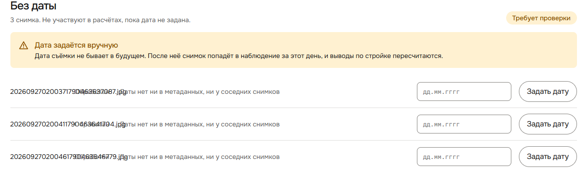

# 005 — Дата съёмки есть в имени файла, но система её не берёт

- **Тип:** улучшение (бэкенд, определение даты)
- **Экран:** Наблюдения → «Без даты»
- **Серьёзность:** средняя — все снимки стенда сейчас без даты, поэтому обзор пуст (см. [002](002-overview-stages-not-started.md))
- **Статус:** исправлен (ветка `bugs-fix`)
- **Где видно:** стенд http://81.26.184.6, стройка «Шмякострой»

## Что видно

Все 3 снимка на стенде попали в «Без даты» с подсказкой «Даты нет ни в метаданных, ни у соседних снимков». При этом дата зашита прямо в имя файла:

| Файл | Префикс `YYYYMMDDhhmmss` (МСК) | Хвост: Unix-время в мс |
|---|---|---|
| `202609270200371790463637087.jpg` | 2026-09-27 02:00:37 | `1790463637087` = 2026-09-26 23:00:37 UTC |
| `202609270200411790463641704.jpg` | 2026-09-27 02:00:41 | `1790463641704` |
| `202609270200461790463646779.jpg` | 2026-09-27 02:00:46 | `1790463646779` |

Обе части имени сходятся с точностью до секунды: 23:00 UTC — это 02:00 по Москве.

Так называют файлы мессенджеры и некоторые камеры при пересылке: EXIF при этом вырезается, а имя остаётся.

## Причина

`backend/app/domains/photo/date_resolver.py:204-230` ищет дату по цепочке: канал → EXIF (`METADATA`) → штамп на кадре (`STAMP`). После обработки пачки `backend/app/domains/photo/service.py:384` пробует взять дату у соседних снимков (`NEIGHBOURS`). Имя файла не проверяется нигде, и отдельного источника для него в `DateSource` (`backend/app/domains/photo/models.py:24-31`) нет.

## Как исправить (предложение)

1. Добавить источник `FILENAME` после EXIF и штампа, но до соседних снимков.
2. Разбирать распространённые шаблоны: `YYYYMMDD_hhmmss`, `IMG_YYYYMMDD_…`, `PXL_YYYYMMDD…`, `YYYY-MM-DD…`, `YYYYMMDDhhmmss…`. Отдельно можно проверять 13-значное Unix-время в мс.
3. Санити-проверка: дата не в будущем и не раньше, например, 2015 года. Если в имени несколько кандидатов и они расходятся больше чем на сутки, дату не ставить.
4. На фронте показывать источник «из имени файла» так же, как остальные (`date_source`), чтобы пользователь видел, откуда взялась дата.

## Проверка после фикса

- Три файла выше после повторной загрузки получают `captured_on = 2026-09-27`, `date_source = filename` и уходят из «Без даты».
- Файл вида `photo.jpg` без даты по-прежнему попадает в «Без даты».

## Исправление

Ветка `bugs-fix`. Добавлен источник `DateSource.FILENAME` («Из имени файла»). Он стоит после EXIF и штампа и до соседних снимков: `parse_filename_date` в `date_resolver.py`. Разбираются `YYYYMMDD[_-.]hhmmss`, `IMG_/PXL_…`, `YYYY-MM-DD`, а также 13-значное Unix-время в мс, отдельно или хвостом после `YYYYMMDDhhmmss` (переводится в МСК). Санити-проверки: не раньше 2015 года, не в будущем, кандидаты расходятся не больше чем на сутки. Для снимков в бэклоге детекции имя тоже пробуется. Уверенность наблюдения с такой датой — не выше «средней», как у штампа и соседей. Три файла из таблицы получают `captured_on = 2026-09-27`, `date_source = filename`; `photo.jpg` без соседей по-прежнему попадает в «Без даты».
