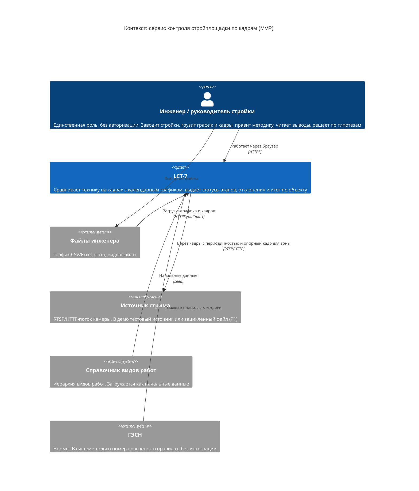
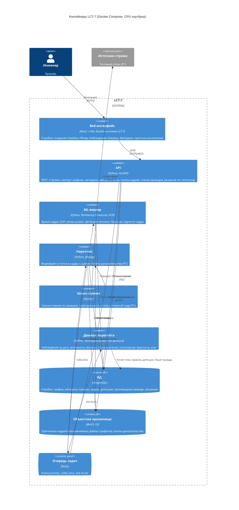
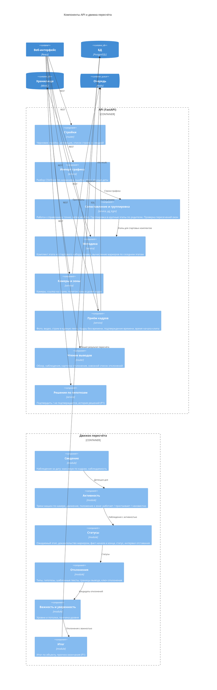
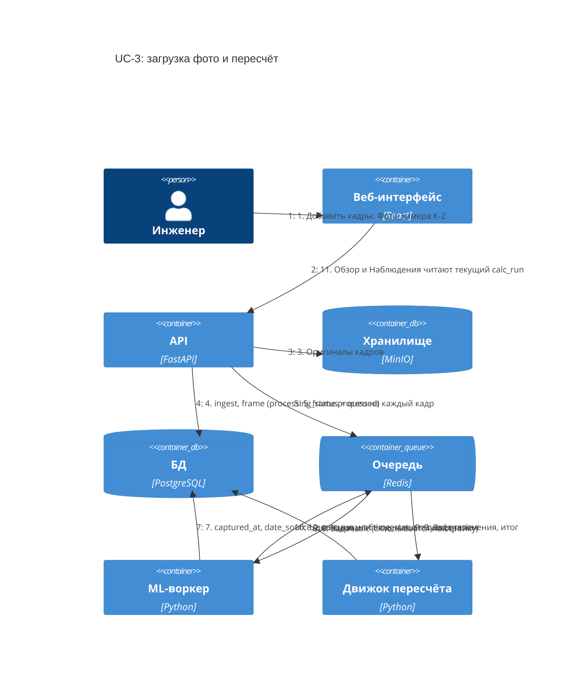
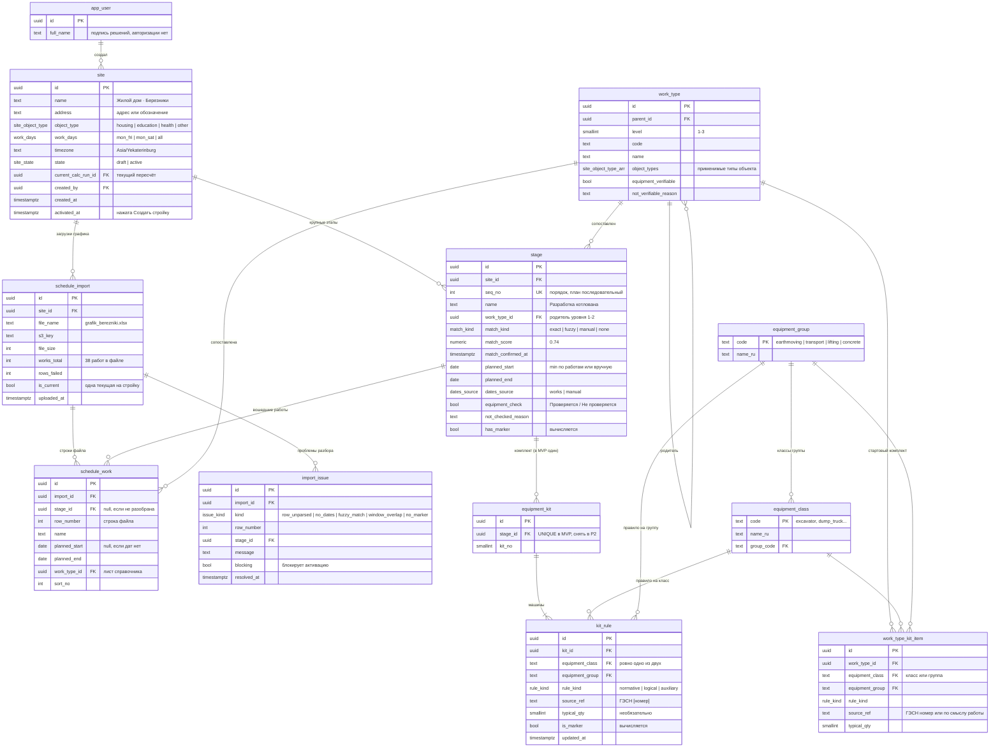
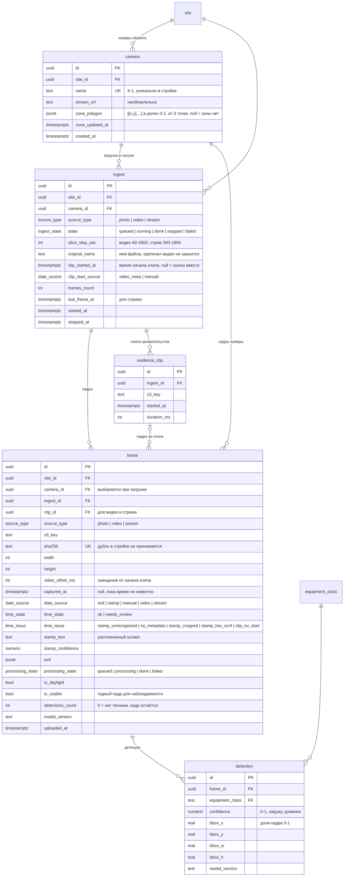
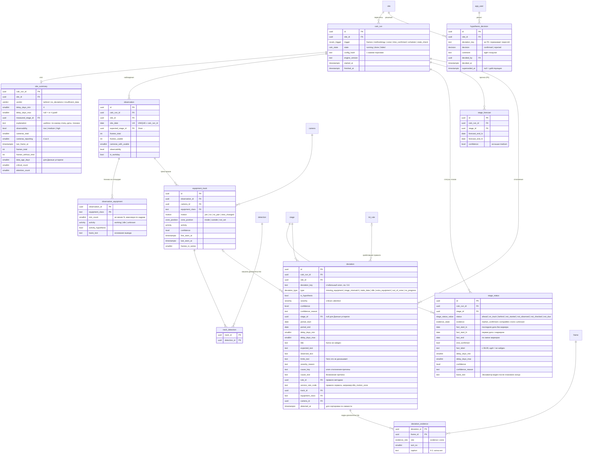

# Модель данных и C4: сервис контроля стройплощадки по кадрам

Источники: `product.md`, `architecture.md`, `mvp.md`, макеты «ЛЦТ — MVP: экраны» (Стройки, Новая стройка, Методика, Камеры, Обзор, Наблюдения, Отклонение).

Документ идёт по уровням C4: контекст → контейнеры → компоненты → динамика загрузки кадра. Своей нотации для данных у C4 нет, поэтому уровень кода (модель БД) дан ER-диаграммами Mermaid, разбитыми на три домена, и словарём таблиц.

## 1. C4 · Уровень 1: контекст



## 2. C4 · Уровень 2: контейнеры



## 3. C4 · Уровень 3: компоненты API и движка



## 4. C4 · Динамика: загрузка фото (UC-3, P0)



## 5. Модель данных

### 5.1. Принципы

1. **Вход и производное разделены.** Вход меняет только инженер или конвейер распознавания: стройка, график, методика, камеры и зоны, кадры, детекции, решения по гипотезам. Производное целиком пересобирается движком: наблюдения, треки, статусы, отклонения, итог. Правка методики или зоны пересобирает производное без повторной обработки изображений.
2. **Производное привязано к пересчёту.** Каждая производная строка несёт `calc_run_id`. Экраны читают `site.current_calc_run_id`. Старые пересчёты удаляются фоном. Интерфейс не видит половину пересчёта, а два пересчёта одной стройки не смешиваются.
3. **Решения по гипотезам переживают пересчёт.** Отклонение пересоздаётся на каждом пересчёте, поэтому решение ссылается не на `deviation.id`, а на стабильный `deviation_key` (см. 5.6).
4. **Оригиналы неизменяемы.** Кадры и файлы лежат в S3, в БД только ключи. Детекции — вывод модели с `model_version`, вывод пользователем не правится.
5. **Пороги не в схеме.** Допуски, окна, пороги уверенности и наблюдаемости живут в конфигурации (раздел 9 `architecture.md`). В `calc_run.config_hash` записывается, с какой конфигурацией посчитано.
6. **Время.** Всё время — `timestamptz`. Дата наблюдения считается в часовом поясе стройки (`site.timezone`): Березники — `Asia/Yekaterinburg`.

### 5.2. Домен «Стройка, график, методика»



### 5.3. Домен «Камеры и кадры»



### 5.4. Домен «Выводы» (производное, пересобирается движком)



### 5.5. Словарь таблиц

**Стройка, график, методика**

| Таблица | Назначение | Ключевые ограничения и индексы |
|---|---|---|
| `app_user` | Один пользователь без авторизации, нужен для подписи решений («Решил: инженер [ФИО]») | seed одной строкой |
| `site` | Стройка. `draft` существует, пока инженер на шагах 1–2 создания, в списке строек не показывается. `active` — после «Создать стройку» | переход `draft → active` только без блокирующих `import_issue` |
| `schedule_import` | Загруженный файл графика и статистика разбора. «Заменить файл» создаёт новую загрузку, прежняя становится не текущей | partial unique `(site_id) WHERE is_current` |
| `schedule_work` | Мелкая работа из файла. Нужна только для группировки и сопоставления, техника на неё не задаётся | index `(stage_id)` |
| `import_issue` | Проблемы блока «Что нужно поправить до создания»: нераспознанные строки, этап без дат, нечёткое сопоставление, пересечение окон, этап без маркера | index `(import_id) WHERE resolved_at IS NULL` |
| `stage` | Крупный этап — единица контроля. Окно считается по работам или задаётся вручную | unique `(site_id, seq_no)`; для `active` исключающее ограничение `EXCLUDE USING gist (site_id WITH =, daterange(planned_start, planned_end, '[]') WITH &&)` через `btree_gist` |
| `work_type` | Справочник видов работ, иерархия уровней 1–3, применимость к типам объекта | trigram-индекс `gin (name gin_trgm_ops)` для нечёткого сопоставления |
| `work_type_kit_item` | Стартовые комплекты на 8–10 крупных этапов, составляем сами | check: ровно одно из `equipment_class`, `equipment_group` |
| `equipment_kit` | Комплект этапа. В MVP один на этап; таблица оставлена ради альтернативных комплектов P2 | unique `(stage_id)` в MVP |
| `kit_rule` | Машина или группа в комплекте: вид правила, источник, типовое количество. Минимум для подтверждения всегда 1 и не хранится | check: ровно одно из класса и группы; check: `rule_kind = 'logical' → NOT is_marker` |
| `equipment_class` / `equipment_group` | Восемь классов из ТЗ и четыре группы: землеройная, транспортная, подъёмная, бетонная | seed |

**Камеры и кадры**

| Таблица | Назначение | Ключевые ограничения и индексы |
|---|---|---|
| `camera` | Камера объекта. Зона — один полигон на камеру, в долях кадра. Опорный кадр для рисования не сохраняется | unique `(site_id, name)`; check `jsonb_array_length(zone_polygon) >= 3` |
| `ingest` | Одна загрузка фото, один видеофайл или одна сессия стрима. Общая сущность для трёх читателей одного нарезчика | index `(camera_id, source_type, state)` |
| `frame` | Кадр — единица входа для любого источника. Кадр без времени (`time_state = needs_review`) хранится, показывается в блоке «Без даты или времени» и не участвует в расчётах | index `(site_id, captured_at)`, `(camera_id, captured_at)`; partial `(site_id) WHERE time_state = 'needs_review'`; unique `(site_id, sha256)` |
| `evidence_clip` | Короткий клип-доказательство из видео или стрима. Оригинал видео не хранится | — |
| `detection` | Рамка техники на кадре. Кадр с `detections_count = 0` — тоже наблюдение | index `(frame_id)` |

**Выводы**

| Таблица | Назначение | Ключевые ограничения и индексы |
|---|---|---|
| `calc_run` | Один пересчёт стройки. Пересчёты одной стройки идут последовательно; `site.current_calc_run_id` переключается только на завершённый | advisory-lock на `site_id` в движке |
| `site_summary` | Итог и «Состояние данных» для Обзора и строки в списке строек | PK = `calc_run_id` |
| `observation` | Наблюдение за дату: кадры, камеры с годными кадрами, наблюдаемость, ожидаемый этап | unique `(calc_run_id, obs_date)` |
| `observation_equipment` | «Техника на площадке»: класс, «не менее N», активность и основание | PK `(observation_id, equipment_class)` |
| `equipment_track` | Машина, сопоставленная между соседними кадрами одной камеры: движение, положение к зоне, активность | index `(observation_id, camera_id)` |
| `track_detection` | Какие детекции составили трек. Детекции при этом не меняются | PK `(track_id, detection_id)` |
| `stage_status` | Строка таблицы этапов: статус, доказательство, факт по маркеру, интервал отставания, уверенность | unique `(calc_run_id, stage_id)` |
| `stage_forecast` | Прогноз окончания, подписан как оценка (P1) | unique `(calc_run_id, stage_id)` |
| `deviation` | Отклонение со всеми полями карточки. Тексты собраны шаблонами при пересчёте | index `(calc_run_id, severity, detected_at DESC)`; check `is_hypothesis → severity = 'attention' AND confidence <> 'high'` |
| `deviation_evidence` | Кадры-доказательства; у гипотезы про положение машины — кадр с зоной камеры (`role = zone`) | PK `(deviation_id, frame_id)` |
| `hypothesis_decision` | Решение инженера по гипотезе. «Изменить решение» закрывает текущее (`superseded_at`) и пишет новое, история сохраняется | partial unique `(site_id, deviation_key) WHERE superseded_at IS NULL` |

### 5.6. Ключ отклонения

`deviation_key` — детерминированная строка, по которой одно и то же отклонение узнаётся в разных пересчётах:

```
{type}:{stage_id | -}:{equipment_class | equipment_group | -}:{camera_id | -}:{episode_start}
```

`episode_start` — первая дата эпизода отклонения. Конец периода в ключ не входит: эпизод растёт с новыми кадрами, а решение инженера должно остаться при нём. Если эпизод прервался и начался снова, это новое отклонение с новым ключом, и решение по нему нужно заново. Пример: `idle:9f1c…:dump_truck:К-2:2026-09-17`.

Чтение карточки гипотезы: `deviation LEFT JOIN hypothesis_decision ON site_id и deviation_key AND superseded_at IS NULL`. Нет решения — «Ждёт решения». `rejected` — отклонение уходит в архив: из списков и отчёта исключается, но в БД остаётся. На `site_summary` решение не влияет.

### 5.7. Перечисления

| Тип | Значения | Подпись в интерфейсе |
|---|---|---|
| `site_object_type` | housing, education, health, other | Жильё, Образование, Здравоохранение, Другое |
| `work_days` | mon_fri, mon_sat, all | Пн–Пт, Пн–Сб, Ежедневно |
| `source_type` | photo, video, stream | Фото, Видео, Стрим |
| `date_source` | exif, stamp, manual, video, stream | Метаданные, Штамп, Вручную, Видео, Поток |
| `time_issue` | stamp_unrecognized, no_metadata, stamp_cropped, stamp_low_conf, clip_no_start | Штамп не распознан, Метаданных нет, Штамп обрезан, Штамп читается неуверенно, Клип без времени начала |
| `rule_kind` | normative, logical, auxiliary | Нормативная, Логическая, Вспомогательная |
| `match_kind` | exact, fuzzy, manual, none | Справочник · точное, Справочник · нечёткое · N%, Вручную, Не сопоставлен |
| `stage_status_value` | ahead, on_track, behind, not_started, not_observed, not_checked, not_due | Опережение, В графике, Отставание, Не начата, Не наблюдалось, Не проверяется по технике, Не начата (not_due и not_started одним бейджем) |
| `evidence_state` | marker_confirmed, compatible, none, unknown | Подтверждено маркером, Совместимо, Нет, Неизвестно |
| `activity` | working, idle, unknown | Работает, Простаивает, Неизвестно |
| `motion` | yes, no, no_pair, view_changed | — (основание вывода) |
| `zone_position` | inside, outside, not_set | Внутри зоны, Вне зоны, Зона не задана |
| `deviation_type` | missing_equipment, stage_mismatch, stale_data, idle, extra_equipment, out_of_zone, no_progress | Нет нужной техники, Несоответствие этапу, Данные устарели, Простой техники, Лишняя техника, Вне рабочей зоны, Нет прогресса |
| `severity` | critical, attention | Критично, Внимание |
| `level` | high, medium, low | Высокая, Средняя, Низкая (уверенность и наблюдаемость) |
| `verdict` | behind, no_deviations, insufficient_data | Отставание X–Y дней, Отклонений не выявлено, Недостаточно данных |
| `decision` | confirmed, rejected | Подтвердить (простой), Не подтверждается (простоя не было) |

### 5.8. Что покрывает какой сценарий

| UC | Пишет | Читает |
|---|---|---|
| UC-1 Завести стройку | `site`, `schedule_import`, `schedule_work`, `stage`, `import_issue` | `work_type` |
| UC-2 Методика | `equipment_kit`, `kit_rule`, `stage.equipment_check` → `calc_run` | `work_type_kit_item`, `schedule_work` (состав этапа) |
| UC-3 Загрузить кадры | `ingest`, `frame`, `evidence_clip`, `detection` → `calc_run` | `camera` |
| UC-4 Обзор | — | `site_summary`, `deviation`, `stage_status`, `observation`, `hypothesis_decision` |
| UC-5 Карточка отклонения | — | `deviation`, `deviation_evidence`, `kit_rule`, `camera.zone_polygon`, `hypothesis_decision` |
| UC-6 Камеры и зоны | `camera` → `calc_run` | `frame` (число кадров) |
| UC-7 Наблюдения | — | `observation`, `observation_equipment`, `equipment_track`, `frame`, `detection` |
| UC-8 Кадры без времени | `frame.captured_at`, `ingest.clip_started_at` → `calc_run` | `frame WHERE time_state = needs_review` |
| UC-9 Стройки | — | `site`, `site_summary`, `deviation` по текущим пересчётам всех строек |
| UC-10 Решение по гипотезе | `hypothesis_decision` | `deviation` |
