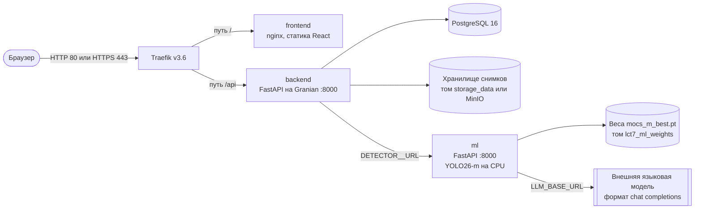
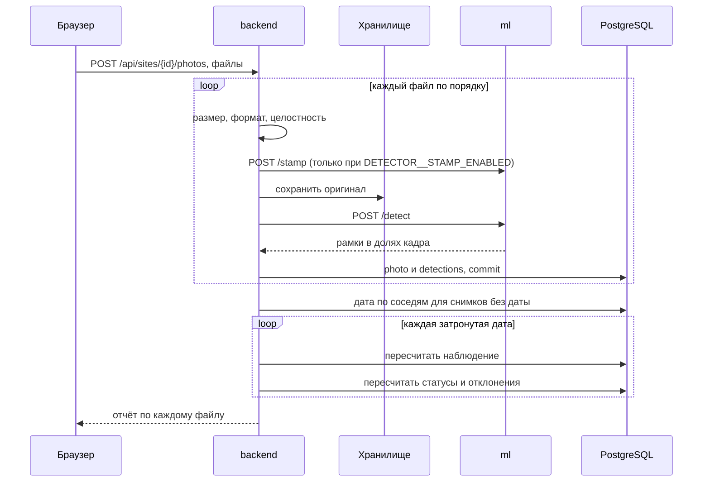
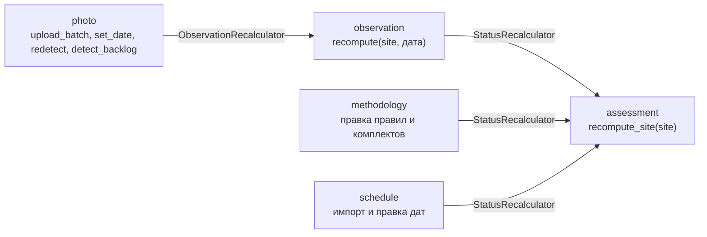

# Архитектура

## Контейнеры

Сервисы поднимаются в Docker Compose, наружу смотрит только Traefik.

| Сервис | Роль |
|---|---|
| `traefik` | Единая точка входа. `/api` уходит в backend (приоритет 20), всё остальное во frontend (приоритет 1). Порт 8080 открывает дашборд без пароля |
| `frontend` | Одностраничное приложение. В dev вместо nginx работает Vite dev-server на порту 5173 |
| `backend` | REST API. При старте контейнера выполняет `alembic upgrade head`, затем запускает Granian |
| `ml` | Распознавание техники, чтение штампа, ассистент, разбор графика моделью |
| `postgres` | Основная база |
| `minio`, `minio-init` | Поднимаются всегда, но бэкенд обращается к ним только при `S3=true`. По умолчанию снимки лежат в томе `storage_data` |

## Потоки данных

### Загрузка снимка

Обработка синхронная. Запрос загрузки возвращается, когда все файлы прошли распознавание и пересчёт закончился. Очереди задач и отдельного воркера нет.

### Цепочка пересчёта

Домены не импортируют друг друга напрямую. Связь идёт через протоколы-хуки, а настоящую реализацию подставляет контейнер зависимостей.

### Внешние системы через адаптеры

Каждая внешняя система скрыта за `Protocol` с двумя реализациями: настоящей и заглушкой.

| Протокол | Реальная реализация | Заглушка |
|---|---|---|
| `DetectorClient` | `HttpDetectorClient` (повторы, ограничение параллелизма, кэш `/meta`) | `NullDetector` |
| `StampOcr` | `HttpStampReader` | `NullStampOcr` |
| `AssistantClient` | `HttpAssistantClient` (без повторов, каждый вызов платный) | `NullAssistantClient` |
| `ScheduleLlmClient` | `HttpScheduleLlmClient` | `NullScheduleLlmClient` |
| `FileStorage` | `S3FileStorage`, `LocalFileStorage` | нет |

## Развёртывание

| Слой compose | Файл | Что добавляет |
|---|---|---|
| Общий | `deploy/docker/common/core.yaml`, `infra.yaml` | Сервисы, метки Traefik, PostgreSQL, MinIO, Traefik |
| Разработка | `deploy/docker/dev/core.yaml` | Локальная сборка, bind-mount исходников, Granian с `--reload`, Vite вместо nginx, порт PostgreSQL наружу |
| Прод | `deploy/docker/prod/core.yaml` | TLS Let's Encrypt, лимиты памяти (backend 512 МБ, frontend 64 МБ, ml 1536 МБ), готовые образы |
