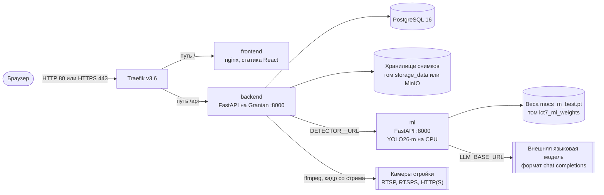
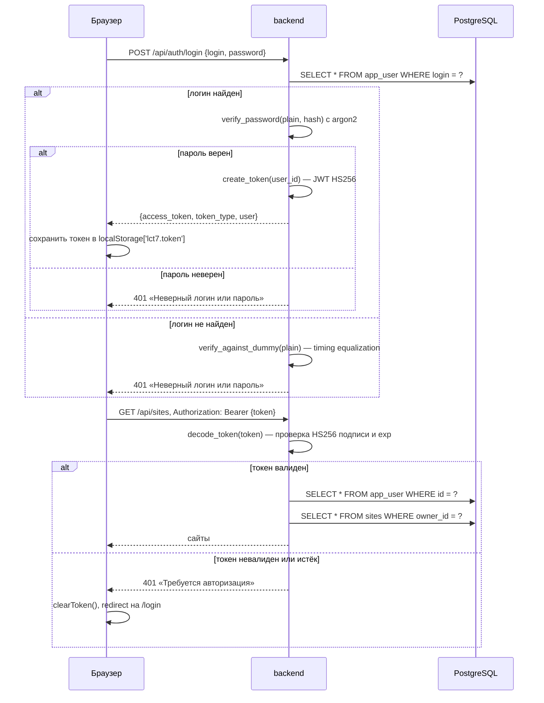
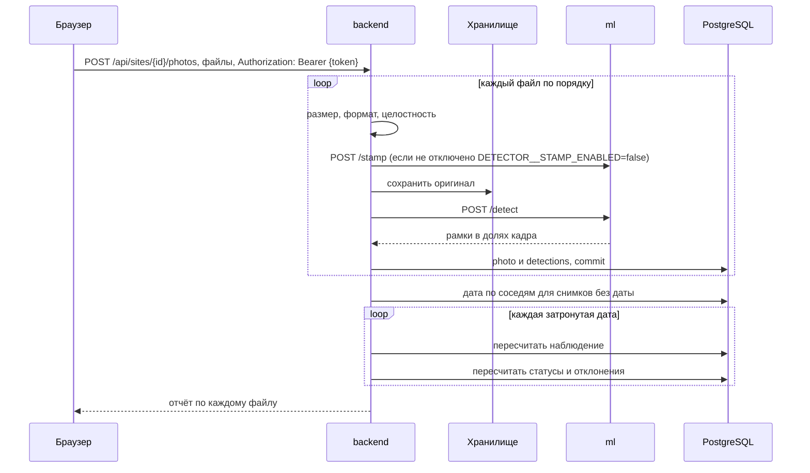
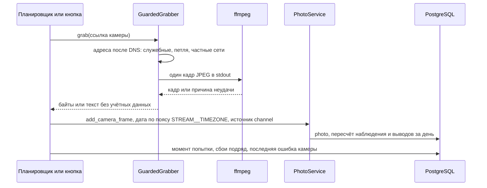
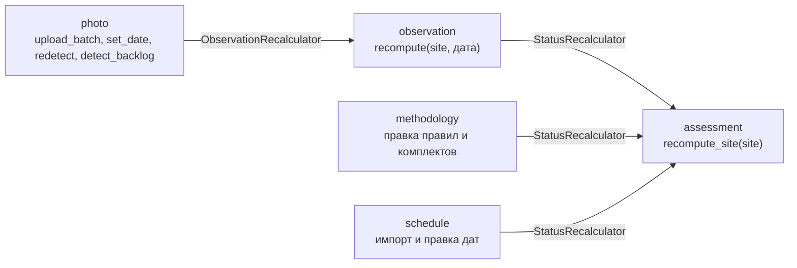

# Архитектура

## Контейнеры

Сервисы поднимаются в Docker Compose, наружу смотрит только Traefik.



| Сервис | Роль |
|---|---|
| `traefik` | Единая точка входа. `/api` уходит в backend (приоритет 20), всё остальное во frontend (приоритет 1). Порт 8080 открывает дашборд без пароля, но только на `127.0.0.1` хоста |
| `frontend` | Одностраничное приложение. В dev вместо nginx работает Vite dev-server на порту 5173 |
| `backend` | REST API. При старте контейнера выполняет `alembic upgrade head`, затем запускает Granian. При `STREAM__ENABLED=true` в том же процессе работает планировщик снимков со стрима камер |
| `ml` | Распознавание техники, чтение штампа, ассистент, разбор графика моделью |
| `postgres` | Основная база |
| `minio`, `minio-init` | Поднимаются всегда, но бэкенд обращается к ним только при `S3=true`. По умолчанию снимки лежат в томе `storage_data` |

## Потоки данных

### Аутентификация и авторизация



Токен хранится в `localStorage['lct7.token']` и передаётся в заголовке `Authorization` при каждом защищённом запросе. Срок жизни токена — `AUTH__TOKEN_TTL_MINUTES` (по умолчанию 720 минут). После истечения пользователь видит 401 на любом эндпоинте и редиректится на /login.

### Загрузка снимка



Обработка синхронная. Запрос загрузки возвращается, когда все файлы прошли распознавание и пересчёт закончился. Очереди задач и отдельного воркера нет.

### Снимок со стрима камеры

Кадр снимает либо фоновый планировщик, либо кнопка «Снять кадр сейчас». Дальше путь тот же, что у загруженного файла, только дата берётся из момента снимка.



Планировщик раз в `STREAM__TICK_S` секунд выбирает камеры, которым пора, и снимает их не больше `STREAM__CONCURRENCY` сразу. Попытка записывается до снимка, поэтому камеру не берут повторно, пока она отвечает. Выборка идёт с `FOR UPDATE SKIP LOCKED`. Это страховка при нескольких репликах, но рассчитано на один экземпляр бэкенда.

### Цепочка пересчёта

Домены не импортируют друг друга напрямую. Связь идёт через протоколы-хуки, а настоящую реализацию подставляет контейнер зависимостей.



### Внешние системы через адаптеры

Большинство внешних систем скрыто за `Protocol` с двумя реализациями: настоящей и заглушкой. У снимков со стрима заглушки нет: без `ffmpeg` снимок завершается ошибкой с причиной, а не пустым результатом.

| Протокол | Реальная реализация | Заглушка |
|---|---|---|
| `DetectorClient` | `HttpDetectorClient` (повторы, ограничение параллелизма, кэш `/meta`) | `NullDetector` |
| `StampOcr` | `HttpStampReader` | `NullStampOcr` |
| `AssistantClient` | `HttpAssistantClient` (без повторов, каждый вызов платный) | `NullAssistantClient` |
| `ScheduleLlmClient` | `HttpScheduleLlmClient` | `NullScheduleLlmClient` |
| `FileStorage` | `S3FileStorage`, `LocalFileStorage` | нет |
| `StreamGrabber` | `FfmpegGrabber`, обёрнут в `GuardedGrabber` (проверка адресов) | нет |
| `NotificationChannel` | `TelegramChannel` поверх `TelegramClient` | `LogChannel` |


### Уведомления

Домен `notification` хранит ленту и привязки каналов. Доменам-источникам доступен один метод, `NotificationService.notify(user_id, type, title, body, link)`: про каналы и телеграм они ничего не знают. Источников событий пока нет — отклонения и сбои камер к этому шву не подключены, лента наполняется только служебным `POST /api/notifications/test`.

Доставка идёт через реестр каналов (`ChannelRegistry`, `Scope.APP`). Реализован один канал, телеграм; без `NOTIFY__TELEGRAM__TOKEN` на его месте `LogChannel`, который только пишет в лог приложения. Почта и СМС не реализованы: интерфейс `NotificationChannel` на них рассчитан, файлов нет.

Отправкой занимается `BackgroundDispatcher`. Сервис создаёт уведомление, коммитит транзакцию и только после этого планирует доставку через `asyncio.create_task`; задача берёт собственную сессию из `async_sessionmaker`, потому что сессия запроса к этому моменту уже закрыта. Ошибка канала пишется в лог и не влияет на HTTP-ответ. Таблицы доставок и повторов нет — следствия описаны в `limitations.md`.

Привязка телеграма устроена так же, как фоновые снимки со стрима: `TelegramLinkPoller` поднимается в `lifespan` и живёт, только если бот настроен. Он опрашивает Bot API методом `getUpdates` (long polling) и на `/start <токен>` гасит одноразовый токен из `channel_link_tokens`, сохраняя `chat_id`. Webhook не используется: ему нужен публичный HTTPS, которого нет при локальной разработке. Курсор апдейтов живёт в памяти задачи — телеграм хранит их сутки, а повторный `/start` по погашенному токену безвреден.

### Прокси для телеграма

`api.telegram.org` заблокирован в России, поэтому телеграм-клиент бэкенда ходит через Xray:

```
TelegramClient --http://xray:8080--> Xray --VLESS--> api.telegram.org
```

Маршрутизации по домену внутри Xray нет намеренно: в прокси попадает только то, что послал
телеграм-клиент, остальной трафик приложения (Postgres, MinIO, LLM, ML) идёт напрямую и Xray
не видит. Вход у Xray — HTTP, а не SOCKS, потому что `httpx` умеет HTTP-прокси без
дополнительных зависимостей.

Живую ссылку среди нескольких выбирает сам Xray, своей логики для этого нет:
`observatory` пингует каждый outbound по `XRAY__PROBE_URL`, а балансировщик со стратегией
`leastPing` шлёт трафик через самый быстрый из отвечающих и переключается, когда тот падает.
Стратегия `leastPing` без `observatory` не запускается — Xray отказывается стартовать с
«not all dependencies are resolved», так что эти две части конфига связаны жёстко.

Конфиг собирает отдельный контейнер `xray-init` из `backend/tools/xray_config.py`: официальный
образ `xray-core` — distroless, в нём нет ни shell, ни Python, поэтому генерировать конфиг
внутри него нечем. Результат кладётся в том `xray_config`, Xray читает его штатным `-confdir`.
Образ бэкенда для этого подходит потому, что скрипт лежит в нём (`COPY . .`), и тот же код
покрыт обычным `pytest`. Healthcheck'а у `xray` нет: в distroless-образе проверять соединение
изнутри нечем, готовность конфига гарантирует `depends_on` на успешно завершившийся `xray-init`.

Если все ссылки мертвы, Xray слушает, но соединения не проходят: `httpx` получает ошибку,
доставка пишет её в лог, привязка остаётся, уведомление остаётся в интерфейсе. Отдельной
обработки для этого не потребовалось — это тот же путь, что и при недоступном Bot API.

## Развёртывание

| Слой compose | Файл | Что добавляет |
|---|---|---|
| Общий | `deploy/docker/common/core.yaml`, `infra.yaml` | Сервисы, метки Traefik, PostgreSQL, MinIO, Traefik |
| Разработка | `deploy/docker/dev/core.yaml` | Локальная сборка, bind-mount исходников, Granian с `--reload`, Vite вместо nginx, порт PostgreSQL наружу |
| Прод | `deploy/docker/prod/core.yaml` | TLS Let's Encrypt, лимиты памяти (backend 512 МБ, frontend 64 МБ, ml 1536 МБ), готовые образы |

В образе backend стоят два системных пакета: `ffmpeg` (снимки со стрима камер) и `fonts-dejavu-core` (кириллица в подписях рамок на аннотированных снимках).
