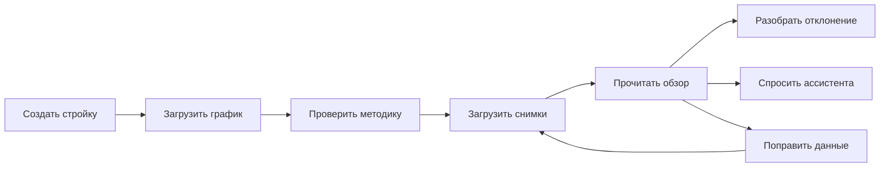
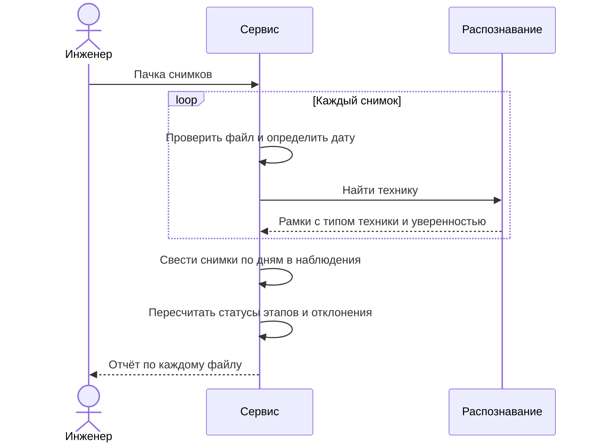
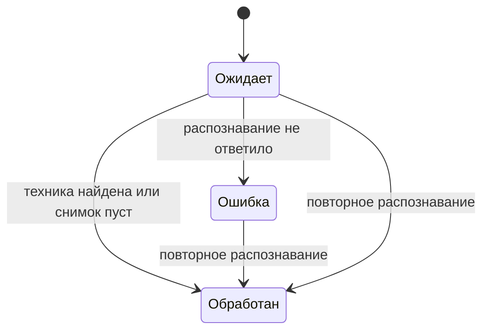
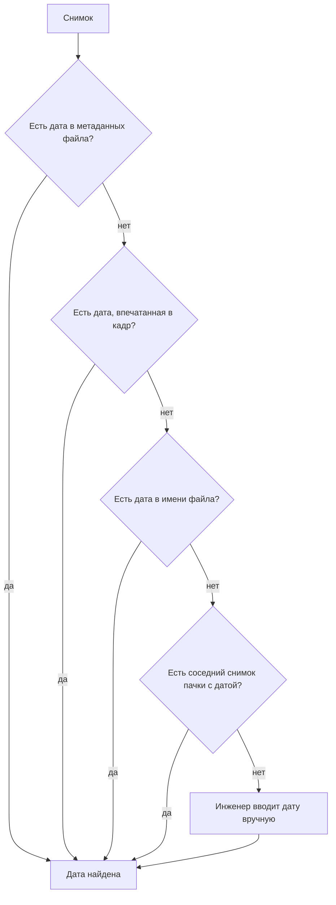
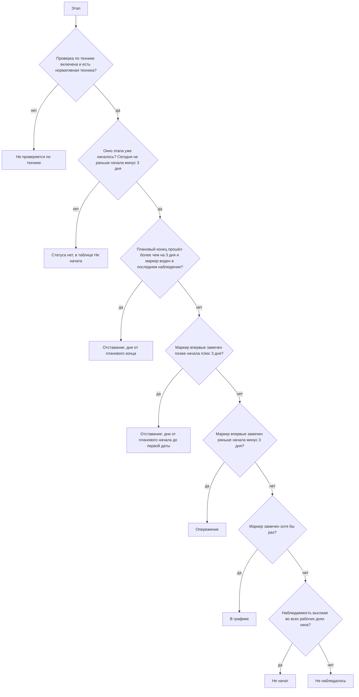
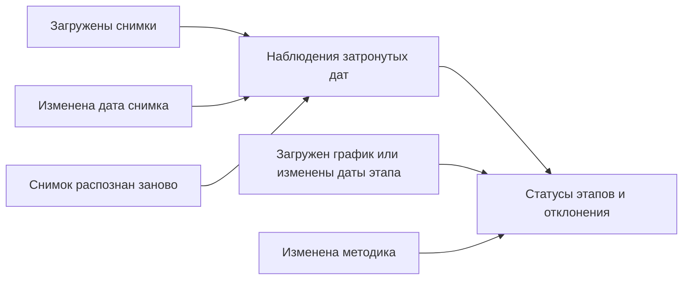

# Бизнес-логика

Сервис отвечает на один вопрос: идут ли работы на стройке по графику.

Инженер загружает график и фотографии площадки. Сервис находит на фотографиях технику, сводит снимки по дням и сравнивает картину каждого дня с планом. Результат по каждому этапу: опережает, идёт по графику, отстаёт, не начат, не наблюдался или не проверяется по технике. К любому выводу прилагаются снимки, уровень уверенности и оговорка о том, чего этот вывод не доказывает.

## Термины

| Термин | Что это |
|---|---|
| Стройка | Объект контроля. У неё есть график, методика, снимки и все выводы |
| График | Таблица работ с плановыми датами начала и окончания. У стройки один график |
| Этап | Одна строка графика. По каждому этапу считается статус |
| Методика | Правила «этап - техника»: какая техника должна быть на площадке, пока идёт этап |
| Комплект | Один из вариантов техники для этапа. Для свай, например, это бурение или забивка копром |
| Требование | Тип техники в комплекте с указанием, насколько она обязательна и откуда взято требование |
| Маркер | Обязательная по нормам техника этапа. Только по ней определяют, что этап начался |
| Наблюдение | Все снимки стройки за один день, сведённые в одну картину |
| Наблюдаемость | Насколько день годится для выводов: высокая, средняя или низкая |
| Уверенность | Насколько сервис уверен в выводе: высокая, средняя или низкая. Процентов нет |
| Отклонение | Расхождение между планом и тем, что видно на снимках |
| Гипотеза | Отклонение по косвенному признаку. Уверенность у него не выше средней, важность не выше «внимание» |

## Что делает пользователь

Роль одна: инженер или руководитель стройки. Вход без пароля.

### Завести стройку и загрузить график

Инженер вводит название и адрес и загружает файл графика в формате CSV или Excel (до 5 МБ). Нужна колонка с названием работы, колонки с датами начала и окончания желательны.

Сервис сам находит шапку таблицы, понимает разные названия колонок («работа», «наименование», «вид работ», «начало», «дата окончания» и подобные), даты в форматах `дд.мм.гггг`, `гггг-мм-дд` и `дд/мм/гггг`, а также настоящие даты Excel. Если встроенный разбор ничего не нашёл, таблицу читает языковая модель. Инженер может выбрать способ разбора сам: только встроенный, только модель или автоматически.

Результат: список этапов с плановыми датами и список строк, которые прочитать не удалось, каждая с причиной (пустое название, непонятная дата, окончание раньше начала). Если у этапа нет дат, инженер задаёт их вручную. Ручные даты помечаются отдельно.

Повторная загрузка графика заменяет прежний целиком: вместе с этапами исчезают ручные даты, настройки методики и все рассчитанные выводы по ним.

### Проверить и настроить методику

Комплекты техники по умолчанию не подставляются. После импорта графика каждый этап получает пустое правило с пометкой «не проверяется» и причиной «Комплект не задан». Инженер сам включает проверку этапа и собирает комплект: какая техника ожидается, насколько она обязательна и откуда взято требование (номер расценки ГЭСН или пометка «по смыслу работы»). Пока проверка не включена, этап получает статус `not_checked` и не влияет на итог.

Что можно менять.

- Отключить проверку этапа по технике, указав причину.
- Добавить, изменить или удалить комплект.
- В комплекте задать тип техники, обязательность и источник.

Что нельзя. Оставить комплект без обязательной по нормам техники: логическая техника не может быть единственным доказательством этапа. Использовать грубый класс «тип не определён». Удалить последний комплект у этапа, который проверяется.

После любой правки сервис пересчитывает выводы по уже загруженным снимкам, повторно распознавать ничего не нужно.

### Загрузить снимки

Инженер выбирает до 50 фотографий (JPEG, PNG или WEBP, каждая до 20 МБ). Ошибка в одном файле не мешает остальным: по каждому файлу сервис отвечает отдельно, принят он или нет и почему.

Снимок проходит несколько состояний.

Снимок без найденной техники остаётся «обработан»: пустой кадр тоже наблюдение. Если сервис распознавания не подключён, снимки остаются в состоянии «ожидает», их можно обработать позже одной кнопкой.

Снимок без определённой даты не участвует в расчётах, но не теряется: он виден отдельным списком, инженер вводит дату вручную (не позже сегодняшней).

### Прочитать состояние объекта

Обзор показывает итог по объекту, таблицу всех этапов со статусами, список отклонений по важности и последнее наблюдение. Этап, до планового начала которого ещё далеко, показан как «Не начата». Правила статусов и итога описаны ниже.

### Разобрать отклонение

Карточка отклонения отвечает на пять вопросов. Что ожидалось. Что найдено. За какой период. Насколько сервис уверен и почему. Чего этот вывод не доказывает. К ней приложены снимки за нужные даты, на них видны рамки вокруг найденной техники.

### Задать вопрос ассистенту

Инженер пишет вопрос по отчёту, например «где отставание и на сколько». Ассистент пересказывает готовые выводы, новых не придумывает. Каждое число в его ответе проверяется по отчёту: если числа там нет или оно относится к другой стройке, ответ помечается как непроверенный. Упоминания «этап N» в ответе становятся ссылками на строки таблицы.

Ограничения: вопрос от 3 до 500 символов, не больше 10 вопросов в минуту, вопрос не по теме отчёта отклоняется. Ассистент работает, только если подключена языковая модель.

## Как сервис понимает снимок

### Дата съёмки

Сервис перебирает источники по порядку и берёт первый, который дал правдоподобную дату.

Пояснения.

- Дату из кадра (штамп камеры) читает распознавание, если эта возможность включена.
- В имени файла понимаются шаблоны вроде `IMG_20260927_020037`, `2026-09-27 02.00.37`, а также время в формате Unix. Год не раньше 2015, дата не из будущего. Если в имени несколько дат и они расходятся больше чем на сутки, сервис не гадает и оставляет снимок без даты.
- Сосед это ближайший по порядку в той же пачке снимок, у которого дата взята из самого файла. При равном расстоянии берётся более ранний. Даты, полученные от соседей, дальше не передаются.
- Источник даты запоминается и показывается: инженер должен отличать то, что пришло с файлом, от того, что вывел сервис.

Сервис работает только с датой, время суток не учитывается.

### Наблюдение за день

Все снимки одной даты сводятся в наблюдение.

**Сколько техники.** Для каждого типа берётся наибольшее число машин, которое видно на одном снимке, а не сумма по снимкам. Одна машина, снятая с пяти точек, остаётся одной машиной. Поэтому число всегда подаётся как «не менее N».

**Насколько сервис уверен в технике.** Берётся меньшая из двух оценок. Первая зависит от уверенности распознавания: от 0.7 высокая, от 0.4 средняя, ниже низкая. Вторая от надёжности даты: если дата взята из кадра, из имени файла или от соседей, уверенность не выше средней.

**Наблюдаемость дня.** Считается по числу успешно обработанных снимков.

| Обработанных снимков за день | Наблюдаемость |
|---|---|
| Три и больше | Высокая |
| Два | Средняя |
| Меньше двух | Низкая |

Наблюдаемость нужна, чтобы отличать «техники нет» от «мы плохо видели площадку». Ракурсы и охват площадки сервис пока не различает: три снимка одного угла дают такую же высокую наблюдаемость, как три снимка разных сторон.

**Активность техники.** Сервис сравнивает положение машин этого типа с предыдущим днём наблюдений. Если центр рамок сдвинулся больше чем на 5 % размера кадра, техника считается работающей, иначе активность неизвестна. Значение «простаивает» сервис не выводит: по двум снимкам разных дней простой не доказать.

## Методика: какая техника нужна на каком этапе

### Что значит «обязательная»

| Обязательность | Смысл | Как влияет |
|---|---|---|
| Нормативная | Машина указана в нормах ГЭСН для этой работы | Это маркер. По ней определяют начало этапа и считают дни отставания |
| Логическая | Нужна по смыслу работы, в нормы не входит. Например, самосвал для вывоза грунта | Её отсутствие даёт только мягкое предупреждение. Подтвердить этап она не может |
| Вспомогательная | Может быть на площадке | Отсутствие не считается отклонением |

### Базовые правила

Этап подбирается по ключевым словам в названии. Побеждает первое совпадение в порядке таблицы.

| Вид работ | Слова в названии | Комплекты |
|---|---|---|
| Свайные работы | свай, буров, бурени | Бурение: буровая установка, бетононасос, фронтальный погрузчик (нормативные), автобетоносмеситель (логическая). Забивка: копёр и фронтальный погрузчик |
| Ограждение котлована | шпунт, огражд, стена в грунте, свг | Шпунт: копёр, гусеничный кран вспомогательный. Стена в грунте: грейфер или гидрофреза, гусеничный кран вспомогательный |
| Разработка котлована | котлован, разработка грунта | Гусеничный экскаватор, самосвал логический |
| Земляные работы | земляные, планировк, засыпк | Бульдозер или колёсный экскаватор, самосвал логический |
| Монолитные работы ниже нуля | монолит, бетонир, фундамент | Башенный кран или бетононасос, автобетоносмеситель логический |
| Возведение каркаса | каркас | Башенный кран или автокран |

Этапы, которые не подошли ни под одно правило (кровля, фасад, отделка, инженерные сети, благоустройство, снос, дорожная одежда), получают статус «не проверяется по технике» и не влияют на итог. Инженер может задать для них комплект вручную.

## Статус этапа

Статус считается для каждого этапа заново при каждом пересчёте. Допуск по датам три дня.

Чем различаются похожие статусы.

| Статус | Смысл |
|---|---|
| Не начат | Утверждение о стройке: площадку видели хорошо, техники этапа там не было |
| Не наблюдалось | Утверждение о данных: снимков мало или они плохие, вывода о стройке нет |
| Не проверяется по технике | У этапа нет обязательной техники или проверка отключена. Ни дней отставания, ни отклонений |
| Не начата | То, что показывает таблица для этапа, до начала которого ещё далеко. Статус не присваивается |

Смешивать «не начат» и «не наблюдалось» нельзя: иначе отсутствие снимков выглядело бы как отсутствие работ.

**Дни отставания или опережения.** Это разница в днях между плановой границей и датой, когда маркер увидели, а не прогноз.

**Уверенность статуса.** Берётся меньшая из двух оценок: уверенность распознавания техники в первый день, когда маркер увидели, и число дней с маркером (две и больше даёт высокую, одна среднюю). Причина уровня записывается в объяснение статуса.

Для статуса «не начат» уверенность высокая, для «не наблюдалось» средняя, если наблюдения были, и низкая, если их не было вовсе. Для «не проверяется» уверенность низкая.

## Отклонения

Отклонения ищутся для этапов, у которых есть статус и он не «не проверяется по технике». Сравнивается самое свежее наблюдение с ожиданиями этапа. Каждое отклонение содержит три текста: что ожидалось, что найдено, чего это не доказывает. Тексты собираются по шаблонам, языковая модель их не пишет.

| Отклонение | Когда возникает | Важность | Гипотеза |
|---|---|---|---|
| Данные устарели | Снимков нет вообще или последний старше 7 дней | Критично | Нет |
| Нет нужной техники | День с высокой наблюдаемостью, обязательной техники этапа на площадке нет | Критично | Нет |
| Нет логической техники | День с высокой наблюдаемостью, нет части логической техники этапа | Внимание | Да |
| Несоответствие этапу | На площадке есть техника, но ни один её тип не входит в требования этапа | Критично | Нет |
| Лишняя техника | Есть техника вне требований этапа, при этом обязательная техника на месте | Внимание | Да |
| Нет прогресса | Два ближайших наблюдения с интервалом до 5 дней, состав техники одинаковый, признаков работы нет | Внимание | Нет |
| Простой техники | Предусмотрено, сейчас не выявляется | Внимание | Да |
| Вне рабочей зоны | Предусмотрено, сейчас не выявляется: рабочих зон в сервисе нет | Внимание | Да |

Если найдено несоответствие этапу, отклонение «нет нужной техники» по тому же этапу не создаётся: это одна и та же ситуация.

Уверенность отклонения зависит от его типа. У «данные устарели» и «нет нужной техники» она высокая, у «нет логической техники» и «нет прогресса» средняя, у остальных равна худшей уверенности техники, на которой оно построено. У гипотез она не выше средней.

## Итог по объекту

| Ситуация | Итог |
|---|---|
| Нет графика или нет ни одного статуса | Недостаточно данных |
| У всех этапов «не наблюдалось» или «не проверяется» | Недостаточно данных |
| Хотя бы один этап отстаёт | Отставание, диапазон дней от наименьшего до наибольшего среди отстающих этапов |
| Иначе | Отклонений не выявлено |

Итог зависит только от статусов этапов. Число критичных отклонений показывается рядом, но на формулировку не влияет.

## Какая дата считается «сегодня»

Статусы и устаревание данных считаются относительно опорной даты. Обычно это сегодняшний день. Для демонстрации на старых снимках есть два других режима: дата последнего наблюдения стройки или одна фиксированная дата. Без этого на фотографиях двухлетней давности сервис показал бы, что данные устарели и этапы отстают на сотни дней. Смена режима вступает в силу при следующем пересчёте.

## Когда выводы пересчитываются

Пересчёт полный: статусы обновляются, отклонения строятся заново. Идентификаторы отклонений при этом не сохраняются, поэтому ссылка на карточку отклонения перестаёт работать после любого изменения данных стройки. Если пересчёт не удался, исходное действие всё равно выполнено: снимок сохранён, правка применена.

## Что учитывать при чтении статусов

Это следствия принятых упрощений.

- Начало этапа определяется по первому снимку с его техникой. Если съёмка началась позже плана или идёт редко, отставание может оказаться завышенным: система не отличает «начали поздно» от «раньше не снимали».
- Маркером служит любая обязательная по нормам машина любого комплекта. Универсальная техника вроде башенного крана или погрузчика может подтвердить этап в одиночку. Количество техники, заданное в требовании, при расчёте не используется.
- Отклонения проверяются по последнему наблюдению для всех этапов, окно которых началось, в том числе завершённых. Завершённый этап может получить отклонение из-за того, что его техники на площадке уже нет.
- Наблюдаемость считается по числу снимков, без учёта того, с каких сторон они сделаны.
- Работа техники определяется по сдвигу между разными днями. Смена ракурса выглядит как движение.
- Сервис проверяет соответствие плану, а не определяет этап по технике: техника пересекается между этапами и надёжно этап не выдаёт.
