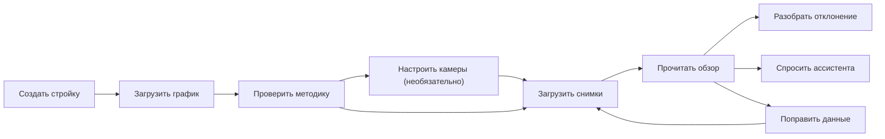
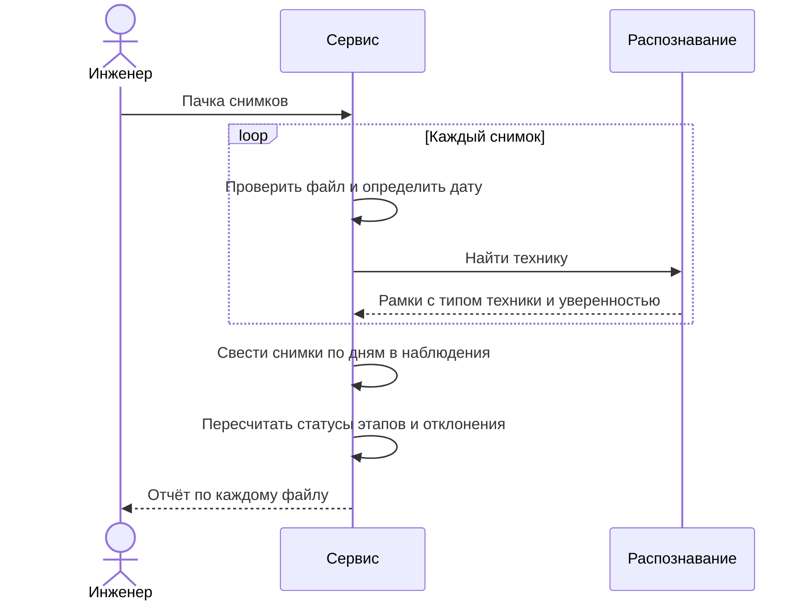
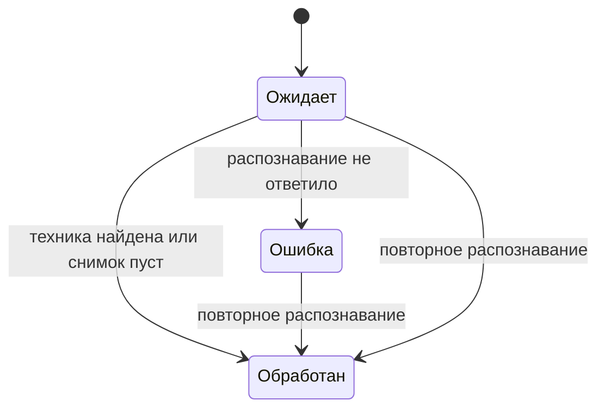
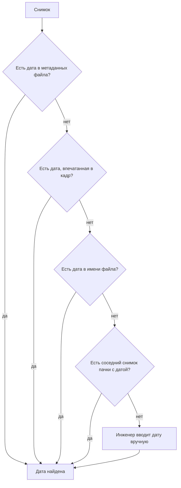
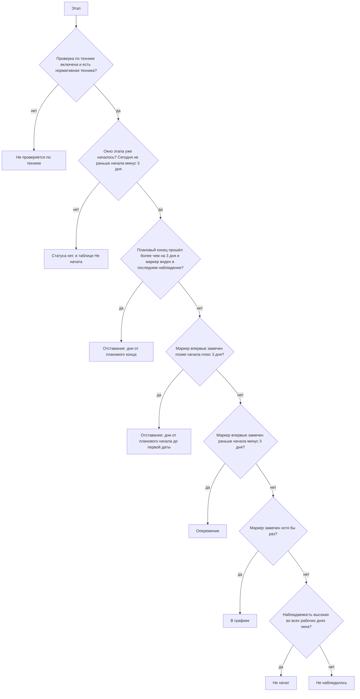
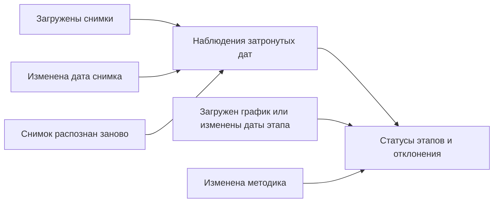

# Бизнес-логика

Сервис отвечает на один вопрос: идут ли работы на стройке по графику.

Инженер загружает график и фотографии площадки. Сервис находит на фотографиях технику, сводит снимки по дням и сравнивает картину каждого дня с планом. Результат по каждому этапу: опережает, идёт по графику, отстаёт, не начат, не наблюдался или не проверяется по технике. К любому выводу прилагаются снимки, уровень уверенности и оговорка о том, чего этот вывод не доказывает.

## Термины

| Термин | Что это |
|---|---|
| Стройка | Объект контроля. У неё есть график, методика, снимки и все выводы |
| График | Таблица работ с плановыми датами начала и окончания. У стройки один график |
| Этап | Одна строка графика. По каждому этапу считается статус |
| Методика | Правила «этап - техника»: какая техника должна быть на площадке, пока идёт этап |
| Комплект | Один из вариантов техники для этапа. Для свай, например, это бурение или забивка копром |
| Требование | Тип техники в комплекте с указанием, насколько она обязательна и откуда взято требование |
| Маркер | Обязательная по нормам техника этапа. Только по ней определяют, что этап начался |
| Наблюдение | Все снимки стройки за один день, сведённые в одну картину |
| Наблюдаемость | Насколько день годится для выводов: высокая, средняя или низкая |
| Уверенность | Насколько сервис уверен в выводе: высокая, средняя или низкая. Процентов нет |
| Отклонение | Расхождение между планом и тем, что видно на снимках |
| Гипотеза | Отклонение по косвенному признаку. Уверенность у него не выше средней, важность не выше «внимание» |

## Что делает пользователь

Роль одна: инженер или руководитель стройки. Вход по логину и паролю, каждый пользователь видит только свои стройки.

### Завести стройку и загрузить график

Инженер вводит название и адрес и загружает файл графика в формате CSV или Excel (до 5 МБ). Нужна колонка с названием работы, колонки с датами начала и окончания желательны.

Сервис сам находит шапку таблицы, понимает разные названия колонок («работа», «наименование», «вид работ», «начало», «дата окончания» и подобные), даты в форматах `дд.мм.гггг`, `гггг-мм-дд` и `дд/мм/гггг`, а также настоящие даты Excel. Если встроенный разбор ничего не нашёл, таблицу читает языковая модель. Инженер может выбрать способ разбора сам: только встроенный, только модель или автоматически.

Результат: список этапов с плановыми датами и список строк, которые прочитать не удалось, каждая с причиной (пустое название, непонятная дата, окончание раньше начала). Если у этапа нет дат, инженер задаёт их вручную. Ручные даты помечаются отдельно.

Повторная загрузка графика заменяет прежний целиком: вместе с этапами исчезают ручные даты, настройки методики и все рассчитанные выводы по ним.

Соседние этапы можно объединить. На шаге создания стройки кнопка «Объединить со следующим» стоит в строке каждого этапа, кроме последнего. Остаётся первый этап с своим названием, а плановое окно становится объединением дат обоих. Техника и правила второго этапа переходят к первому, одинаковые комплекты не дублируются. Если хотя бы один из двух этапов правили вручную, даты помечаются как ручные. Объединённый этап проверяется по технике, если проверялся любой из двух.

### Проверить и настроить методику

Комплекты техники сами не подставляются. После импорта графика каждый этап получает пустое правило с пометкой «не проверяется» и причиной «Комплект не задан». Дальше два пути. Кнопка «Подставить базовые комплекты» заполняет пустые правила из [базовых правил](#базовые-правила) по названию этапа и сразу включает проверку; этапы, которые не подошли ни под одно правило, и уже настроенные этапы она не трогает. Либо инженер сам включает проверку и собирает комплект: какая техника ожидается, насколько она обязательна и откуда взято требование (номер расценки ГЭСН или пометка «по смыслу работы»). Пока проверка не включена, этап получает статус `not_checked` и не влияет на итог.

Что можно менять.

- Отключить проверку этапа по технике, указав причину.
- Добавить, изменить или удалить комплект.
- В комплекте задать тип техники, обязательность и источник.

Что нельзя. Оставить комплект без обязательной по нормам техники: логическая техника не может быть единственным доказательством этапа. Использовать грубый класс «тип не определён». Удалить последний комплект у этапа, который проверяется.

После любой правки сервис пересчитывает выводы по уже загруженным снимкам, повторно распознавать ничего не нужно.

### Настроить камеры и рабочую зону

Камеры заводятся на вкладке «Камеры» (`/sites/:id/cameras`). Камера необязательна: без неё снимки загружаются вручную, как раньше.

У камеры есть название, ссылка на стрим (`rtsp://`, `rtsps://`, `http://` или `https://`) и интервал съёмки. В ответах пароль из ссылки заменён на `***`. Если вернуть маскированную ссылку как есть, сохранённый пароль не меняется. «Снять кадр сейчас» сразу берёт кадр и кладёт его в ленту стройки.

Рабочая зона — многоугольник из трёх и больше вершин, который инженер ставит на кадре камеры. Техника считается внутри зоны, если центр нижней кромки её рамки попадает в многоугольник: там машина стоит на земле. Для дня проверка такая. Тип техники считается внутри зоны, если хотя бы одна его рамка за день внутри зоны. Вне зоны он только тогда, когда все его рамки на зонированных камерах снаружи. Зона действует только на снимки этой камеры. Снимки без камеры и снимки с камерой без зоны в проверке не участвуют, отклонение «Вне рабочей зоны» по ним не возникает.

Удаление камеры не удаляет её снимки: они остаются в ленте без камеры. Правка зоны или ссылки сама по себе выводы не пересчитывает. Они обновятся при ближайшем пересчёте, то есть при загрузке снимков, правке графика или методики.

### Снимки со стрима камер

Снимки можно брать и автоматически. Фоновый планировщик включается настройкой `STREAM__ENABLED`, по умолчанию он выключен (см. [configuration.md](configuration.md#снимки-со-стрима-камер)). Он снимает камеру с её интервалом (по умолчанию пять минут), только в часы стройки (по умолчанию с 8:00 до 20:00 по Москве). После трёх сбоев подряд интервал растёт: удваивается с каждым следующим сбоем, но не дольше часа (предел задаётся `STREAM__MAX_BACKOFF_S`). Удачный кадр возвращает обычный интервал.

Кадр проходит ту же обработку, что загруженный файл: распознавание техники, наблюдение за день, пересчёт выводов. Дата кадра берётся по моменту снятия, источник даты — `channel`. В расчёте учитывается только день. Время съёмки сохраняется лишь в имени файла (`stream-ГГГГММДД-ЧЧММСС.jpg`). Ручной снимок «Снять кадр сейчас» работает в любое время суток, даже когда планировщик выключен.

Причина неудачи (камера не ответила, отказала в доступе, адрес закрыт настройками) показывается у камеры. В ней нет пароля из ссылки.

### Загрузить снимки

Инженер выбирает до 50 фотографий общим объёмом до 200 МБ (JPEG, PNG или WEBP, каждая до 20 МБ). Пачку больше этих пределов сервис отклоняет целиком. Ошибка в одном файле не мешает остальным: по каждому файлу сервис отвечает отдельно, принят он или нет и почему. Через API снимок можно привязать к камере (поле `camera_id`), и тогда он проходит проверку зоны этой камеры. В интерфейсе загрузки такой привязки пока нет.

Снимок проходит несколько состояний.

Снимок без найденной техники остаётся «обработан»: пустой кадр тоже наблюдение. Если сервис распознавания не подключён, снимки остаются в состоянии «ожидает», их можно обработать позже одной кнопкой.

Снимок без определённой даты не участвует в расчётах, но не теряется: он виден отдельным списком, инженер вводит дату вручную (не позже сегодняшней).

### Прочитать состояние объекта

Обзор показывает итог по объекту, таблицу всех этапов со статусами, список отклонений по важности и последнее наблюдение. Этап, до планового начала которого ещё далеко, показан как «Не начата». Правила статусов и итога описаны ниже.

### Разобрать отклонение

Карточка отклонения отвечает на пять вопросов. Что ожидалось. Что найдено. За какой период. Насколько сервис уверен и почему. Чего этот вывод не доказывает. К ней приложены снимки за нужные даты, на них видны рамки вокруг найденной техники. Подпись рамки по-русски: название техники и уверенность в процентах. Если на сервере нет шрифта с кириллицей, подпись строится по коду класса, например `excavator_crawler 87%`.

### Отчёт для печати и PDF

Отчёт по объекту открывается на `/sites/:id/report`. Это документ A4 без интерфейса: итог по объекту с пояснением, отклонения с основанием и уверенностью, этапы с планом, статусом и основанием, состояние данных и раздел «Чего отчёт не утверждает». Данные те же, что на обзоре.

Кнопка «Скачать отчёт PDF» на обзоре открывает отчёт и сразу предлагает печать. PDF получается через «Сохранить как PDF» в диалоге браузера, на сервере файл не создаётся. Имя файла браузер берёт из заголовка «Отчёт — название стройки — дата».

В отчёт не входят снимки и рамки, список камер и зоны, правила методики, ошибки разбора графика и ответы ассистента.

### Задать вопрос ассистенту

Инженер пишет вопрос по отчёту, например «где отставание и на сколько». Ассистент пересказывает готовые выводы, новых не придумывает. Каждое число в его ответе проверяется по отчёту: если числа там нет или оно относится к другой стройке, ответ помечается как непроверенный. Упоминания «этап N» в ответе становятся ссылками на строки таблицы.

Ограничения: вопрос от 3 до 500 символов, не больше 10 вопросов в минуту, вопрос не по теме отчёта отклоняется. Ассистент работает, только если подключена языковая модель.

Колонка ассистента видна и без модели. Тогда форма заблокирована и выводится пометка «Ассистент не подключён»: отчёт и остальной сервис работают. Если модель стала недоступна уже после проверки, вопрос не списывается из лимита. Текст, который уходит модели (названия этапов, тексты отклонений), очищается: управляющие символы убираются, угловые скобки заменяются похожими знаками, чтобы текст из графика не мог закрыть служебный тег в запросе.

## Как сервис понимает снимок

### Дата съёмки

Сервис перебирает источники по порядку и берёт первый, который дал правдоподобную дату.

Пояснения.

- Дату из кадра (штамп камеры) читает распознавание (оба нижних угла, по умолчанию включено).
- Кадр со стрима камеры получает дату момента снятия (источник `channel`). Этот источник приоритетнее всех остальных, штамп и имя файла для такого кадра не смотрятся.
- В имени файла понимаются шаблоны вроде `IMG_20260927_020037`, `2026-09-27 02.00.37`, а также время в формате Unix. Год не раньше 2015, дата не из будущего. Если в имени несколько дат и они расходятся больше чем на сутки, сервис не гадает и оставляет снимок без даты.
- Сосед это ближайший по порядку в той же пачке снимок, у которого дата взята из самого файла. При равном расстоянии берётся более ранний. Даты, полученные от соседей, дальше не передаются.
- Источник даты запоминается и показывается: инженер должен отличать то, что пришло с файлом, от того, что вывел сервис.

Сервис работает только с датой, время суток не учитывается.

### Наблюдение за день

Все снимки одной даты сводятся в наблюдение.

**Сколько техники.** Для каждого типа берётся наибольшее число машин, которое видно на одном снимке, а не сумма по снимкам. Одна машина, снятая с пяти точек, остаётся одной машиной. Поэтому число всегда подаётся как «не менее N».

**Насколько сервис уверен в технике.** Берётся меньшая из двух оценок. Первая зависит от уверенности распознавания: от 0.7 высокая, от 0.4 средняя, ниже низкая. Вторая от надёжности даты: если дата взята из кадра, из имени файла или от соседей, уверенность не выше средней.

**Наблюдаемость дня.** Считается по числу успешно обработанных снимков.

| Обработанных снимков за день | Наблюдаемость |
|---|---|
| Три и больше | Высокая |
| Два | Средняя |
| Меньше двух | Низкая |

Наблюдаемость нужна, чтобы отличать «техники нет» от «мы плохо видели площадку». Ракурсы и охват площадки сервис пока не различает: три снимка одного угла дают такую же высокую наблюдаемость, как три снимка разных сторон. Камера на наблюдаемость не влияет: три кадра с одной камеры дают высокую наблюдаемость так же, как три кадра с разных.

**Активность техники.** Сервис сравнивает положение машин этого типа с предыдущим днём наблюдений. Если центр рамок сдвинулся больше чем на 5 % размера кадра, техника считается работающей, иначе активность неизвестна. Значение «простаивает» сервис не выводит: по двум снимкам разных дней простой не доказать.

## Методика: какая техника нужна на каком этапе

### Что значит «обязательная»

| Обязательность | Смысл | Как влияет |
|---|---|---|
| Нормативная | Машина указана в нормах ГЭСН для этой работы | Это маркер. По ней определяют начало этапа и считают дни отставания |
| Логическая | Нужна по смыслу работы, в нормы не входит. Например, самосвал для вывоза грунта | Её отсутствие даёт только мягкое предупреждение. Подтвердить этап она не может |
| Вспомогательная | Может быть на площадке | Отсутствие не считается отклонением |

### Базовые правила

Их подставляет кнопка «Подставить базовые комплекты». Этап подбирается по ключевым словам в названии, побеждает первое совпадение в порядке таблицы. В скобках логическая техника.

| Вид работ | Слова в названии | Комплекты |
|---|---|---|
| Свайные работы | свай, буров, бурени | Бурение: буровая установка (бетононасос, фронтальный погрузчик, автобетоносмеситель). Забивка: копёр (фронтальный погрузчик) |
| Ограждение котлована | шпунт, огражд, стена в грунте, свг | Шпунт: копёр, гусеничный кран вспомогательный. Стена в грунте: грейфер или гидрофреза, гусеничный кран вспомогательный |
| Разработка котлована | котлован, разработка грунта | Гусеничный экскаватор (самосвал) |
| Земляные работы | земляные, земляных, планировк, засыпк | Бульдозер (самосвал) или колёсный экскаватор (самосвал) |
| Возведение каркаса | каркас | Башенный кран или автокран |
| Монолитные работы ниже нуля | монолит, бетонир, фундамент | Башенный кран (автобетоносмеситель) или бетононасос (автобетоносмеситель) |
| Снос зданий | снос зданий, снос строений, демонтаж здани, демонтаж строени | Гусеничный экскаватор (самосвал) |
| Дорожная одежда | дорожная одежда, асфальт | Асфальтоукладчик и каток вместе (самосвал) |
| Наружные инженерные сети | наружные сети, наружных сетей, наружные инженерные, наружных инженерных | Гусеничный экскаватор и автокран вместе (самосвал) |

Этапы, которые не подошли ни под одно правило (кровля, фасад, отделка, внутренние инженерные системы, благоустройство), остаются «не проверяется по технике» и не влияют на итог. Инженер может задать для них комплект вручную.

### Когда комплект выполнен

Комплект выполнен за день, если в наблюдении есть вся его нормативная техника, каждой машины не меньше `min_count`. Логическая и вспомогательная техника на выполнение не влияет. День, когда выполнен хотя бы один комплект этапа, считается днём с маркером.

Машины делятся на специфичные и универсальные. Специфичные привязаны к узкому кругу работ: буровая установка, копёр, грейфер, бетононасос, каток, автогрейдер, асфальтоукладчик. Список зеркалит `ml/configs/rules.json` и хранится константой `SPECIFIC_EQUIPMENT_CODES` в `backend/app/domains/methodology/catalog.py`. Подтверждение сильное, если в выполненном комплекте есть специфичная нормативная машина или вся его логическая техника на месте. Комплект без логической техники тоже считается сильным.

## Статус этапа

Статус считается для каждого этапа заново при каждом пересчёте. Допуск по датам три дня.

Чем различаются похожие статусы.

| Статус | Смысл |
|---|---|
| Не начат | Утверждение о стройке: площадку видели хорошо, техники этапа там не было |
| Не наблюдалось | Утверждение о данных: снимков мало или они плохие, вывода о стройке нет |
| Не проверяется по технике | У этапа нет обязательной техники или проверка отключена. Ни дней отставания, ни отклонений |
| Не начата | То, что показывает таблица для этапа, до начала которого ещё далеко. Статус не присваивается |

Смешивать «не начат» и «не наблюдалось» нельзя: иначе отсутствие снимков выглядело бы как отсутствие работ.

**Дни отставания или опережения.** Это разница в днях между плановой границей и датой, когда маркер увидели, а не прогноз.

**Уверенность статуса.** Берётся меньшая из двух оценок: уверенность распознавания техники в первый день, когда маркер увидели, и число дней с маркером (две и больше даёт высокую, одна среднюю). Если ни в один день с маркером подтверждение не было сильным, уверенность не выше низкой, а причина «подтверждено только универсальной техникой». Причина уровня записывается в объяснение статуса.

Для статуса «не начат» уверенность высокая, для «не наблюдалось» средняя, если наблюдения были, и низкая, если их не было вовсе. Для «не проверяется» уверенность низкая.

## Отклонения

Отклонения ищутся для этапов, у которых есть статус и он не «не проверяется по технике». Сравнивается самое свежее наблюдение с ожиданиями этапа, но только если этап идёт по графику в день этого наблюдения (с допуском) или его маркеры ещё видны: завершённый или будущий этап не получает отклонений по чужому снимку. В «ожидалось» перечислена техника этапа по методике. Каждое отклонение содержит три текста: что ожидалось, что найдено, чего это не доказывает. Тексты собираются по шаблонам, языковая модель их не пишет.

| Отклонение | Когда возникает | Важность | Гипотеза |
|---|---|---|---|
| Данные устарели | Последний снимок старше 7 дней. Если снимков нет вообще, отклонения нет: этапы получают статус «Не наблюдалось» | Критично | Нет |
| Нет нужной техники | День с высокой наблюдаемостью, обязательной техники этапа на площадке нет | Критично | Нет |
| Нет логической техники | День с высокой наблюдаемостью, нет части логической техники этапа | Внимание | Да |
| Несоответствие этапу | На площадке есть техника, но ни один её тип не входит в требования этапа | Критично | Нет |
| Лишняя техника | Есть техника вне требований этапа, при этом обязательная техника на месте | Внимание | Да |
| Отставание от графика | Этап со статусом «Отстаёт»: работы начались позже плана или план закончился, а маркерная техника ещё на площадке; в тексте указано число дней | Внимание | Нет |
| Нет прогресса | Два ближайших наблюдения с интервалом до 5 дней, состав техники одинаковый, признаков работы нет | Внимание | Нет |
| Простой техники | Предусмотрено, сейчас не выявляется | Внимание | Да |
| Вне рабочей зоны | В последнем наблюдении есть тип техники, все рамки которого на зонированных камерах вне зоны. Нужна зона хотя бы у одной камеры. Проверяется только у проверяемых этапов в рабочем окне | Внимание | Да |

Если найдено несоответствие этапу, отклонение «нет нужной техники» по тому же этапу не создаётся: это одна и та же ситуация.

Уверенность отклонения зависит от его типа. У «данные устарели» и «нет нужной техники» она высокая, у «нет логической техники» и «нет прогресса» средняя, у остальных равна худшей уверенности техники, на которой оно построено. У гипотез она не выше средней.

## Итог по объекту

| Ситуация | Итог |
|---|---|
| Нет графика или нет ни одного статуса | Недостаточно данных |
| У всех этапов «не наблюдалось» или «не проверяется» | Недостаточно данных |
| Хотя бы один этап отстаёт | Отставание, диапазон дней от наименьшего до наибольшего среди отстающих этапов |
| Иначе | Отклонений не выявлено |

Итог зависит только от статусов этапов. Число критичных отклонений показывается рядом, но на формулировку не влияет.

## Какая дата считается «сегодня»

Статусы и устаревание данных считаются относительно опорной даты. Обычно это сегодняшний день. Для демонстрации на старых снимках есть два других режима: дата последнего наблюдения стройки или одна фиксированная дата. Без этого на фотографиях двухлетней давности сервис показал бы, что данные устарели и этапы отстают на сотни дней. Смена режима вступает в силу при следующем пересчёте.

## Когда выводы пересчитываются

Пересчёт полный: статусы обновляются, отклонения строятся заново. Идентификаторы отклонений при этом не сохраняются, поэтому ссылка на карточку отклонения перестаёт работать после любого изменения данных стройки. Если пересчёт не удался, исходное действие всё равно выполнено: снимок сохранён, правка применена.

## Что учитывать при чтении статусов

Это следствия принятых упрощений.

- Начало этапа определяется по первому снимку с его техникой. Если съёмка началась позже плана или идёт редко, отставание может оказаться завышенным: система не отличает «начали поздно» от «раньше не снимали».
- Универсальная техника всё ещё может подтвердить этап, если она одна составляет комплект. Такое подтверждение получает низкую уверенность, кроме комплектов без логической техники: башенный кран, который месяцами стоит на площадке, подтверждает «Возведение каркаса» с обычной уверенностью.
- Этап вне своего планового окна (с допуском) получает отклонения по последнему наблюдению, только если этот день входит в основание его статуса, например его маркер виден в этот день. Иначе для него проверяется одно «Нет прогресса», и завершённый этап может получить его по снимкам после своего окончания.
- Наблюдаемость считается по числу снимков, без учёта того, с каких сторон они сделаны.
- «Вне рабочей зоны» проверяет всю технику последнего наблюдения, а не только ту, что нужна этапу. Поэтому такое отклонение появляется у каждого проверяемого этапа в рабочем окне, если какой-либо тип техники дня весь стоит вне зоны своей камеры. Зона отвечает на вопрос «где стоит», но не «нужна ли эта техника этапу».
- Работа техники определяется по сдвигу между разными днями. Смена ракурса выглядит как движение.
- Сервис проверяет соответствие плану, а не определяет этап по технике: техника пересекается между этапами и надёжно этап не выдаёт.
