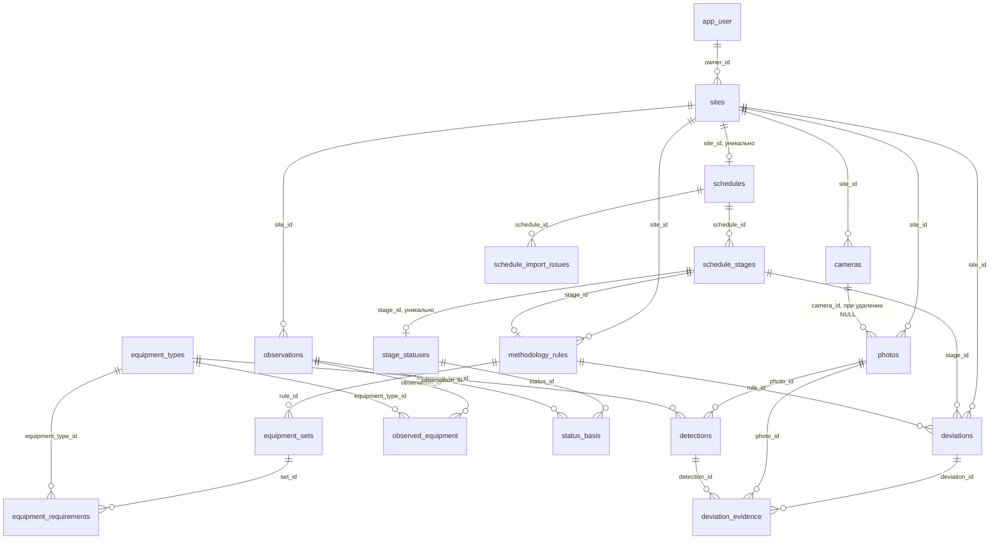

# Модель данных

| Что | Таблицы | Комментарий |
|---|---|---|
| Техника, справочник | `equipment_types` | 25 записей: 20 конкретных классов и 5 грубых (`*_unknown`), которые модель возвращает, когда не различает подтип. Грубые классы нельзя использовать в требованиях методики |
| Техника на снимке | `detections` | Рамка в долях кадра, уверенность модели, версия модели |
| Техника за день | `observed_equipment` | Тип, «не менее N», активность, уверенность. Часть наблюдения за дату |
| Техника, которую ждёт методика | `equipment_requirements` внутри `equipment_sets` внутри `methodology_rules` | Минимум, обязательность, источник требования |
| Этапы работ | `schedules`, `schedule_stages`, `schedule_import_issues` | Этап это строка графика. Ошибки разбора файла хранятся отдельно |
| Статус этапа | `stage_statuses`, `status_basis` | Статус, дни отставания, уверенность и её причина. `status_basis` хранит, какие наблюдения легли в основу |
| Отклонения (нарушения) | `deviations`, `deviation_evidence` | Тип, важность, уверенность, период, тексты «ожидалось», «наблюдается», «границы вывода», ссылка на правило, снимки-доказательства |
| Снимки | `photos` | Метаданные, источник даты, статус распознавания, камера (необязательно). Файл лежит в хранилище, в базе только ключ |
| Камеры стройки | `cameras` | Название, ссылка на стрим, интервал съёмки, состояние последней попытки, рабочая зона |

## Диаграмма связей



## Словарь таблиц

### Пользователь и стройка

`app_user`. Пользователи системы.

| Столбец | Тип | Ограничения | Смысл |
|---|---|---|---|
| `id` | uuid | PK, без значения по умолчанию | Идентификатор, или в dev-режиме фиксированный стендовый ID |
| `full_name` | varchar(255) | не пусто | Имя пользователя. По умолчанию логин |
| `login` | varchar(64) | уникально, может быть пусто | Логин для входа (нижний регистр). NULL если вход не привязан |
| `password_hash` | varchar(255) | может быть пусто | Хеш пароля (argon2). NULL если вход не привязан |
| `created_at` | timestamptz | по умолчанию `now()` | |

`sites`.

| Столбец | Тип | Ограничения | Смысл |
|---|---|---|---|
| `id` | uuid | PK | |
| `name` | varchar(255) | не пусто | Название |
| `address` | varchar(500) | может быть пусто | Адрес или условное обозначение |
| `object_type` | varchar(16) | по умолчанию `other` | `housing`, `education`, `health`, `other` |
| `workdays` | json | по умолчанию `[0, 1, 2, 3, 4]` | Рабочие дни, пн=0…вс=6. Вход движка: в нерабочий день отсутствие техники — не отклонение. Правка сразу пересчитывает статусы |
| `owner_id` | uuid | FK `app_user.id`, индекс | Владелец. Доступ к стройке проверяется по нему |
| `created_at`, `updated_at` | timestamptz | по умолчанию `now()` | |

### График

`schedules`. Один график на стройку.

| Столбец | Тип | Ограничения | Смысл |
|---|---|---|---|
| `id` | uuid | PK | |
| `site_id` | uuid | FK `sites.id` CASCADE, уникально | |
| `source_filename` | varchar(255) | | Имя загруженного файла |
| `imported_at` | timestamptz | | |
| `rows_total`, `rows_parsed` | integer | | Строк в файле и разобрано |
| `parse_method` | varchar(16) | `builtin` или `llm`, по умолчанию `builtin` | Чем файл разобран на самом деле. Интерфейс предупреждает, что даты после модели стоит проверить |

`schedule_stages`.

| Столбец | Тип | Ограничения | Смысл |
|---|---|---|---|
| `id` | uuid | PK | |
| `schedule_id` | uuid | FK `schedules.id` CASCADE | |
| `name` | varchar(500) | | Очищенное название: переносы и повторные пробелы свёрнуты, длинное обрезано с многоточием |
| `position` | integer | | Порядок в файле, с единицы |
| `planned_start`, `planned_end` | date | могут быть пусто | Плановые даты |
| `dates_source` | varchar(16) | `file` или `manual` | Ручная правка меняет источник |

`schedule_import_issues`. Строки, которые не удалось разобрать.

| Столбец | Тип | Смысл |
|---|---|---|
| `id` | uuid | PK |
| `schedule_id` | uuid | FK CASCADE |
| `row_number` | integer | Номер строки в файле |
| `raw_row` | text | Содержимое строки |
| `reason` | varchar(500) | Причина: пустое название, дата не разобрана, окончание раньше начала |

### Методика

`equipment_types`. Справочник техники.

| Столбец | Тип | Ограничения | Смысл |
|---|---|---|---|
| `id` | uuid | PK | |
| `code` | varchar(64) | уникально, индекс | Код класса, совпадает с классом модели, например `excavator_crawler` |
| `title` | varchar(255) | | Русское название |
| `synonyms` | json | список строк | |
| `is_coarse` | boolean | по умолчанию `false` | Грубый класс, в требованиях запрещён |

`methodology_rules`. Правило проверки этапа.

| Столбец | Тип | Ограничения | Смысл |
|---|---|---|---|
| `id` | uuid | PK | |
| `site_id` | uuid | FK `sites.id` CASCADE | |
| `stage_id` | uuid | FK `schedule_stages.id` CASCADE | |
| `stage_key` | varchar(64) | | Ключ базового правила, например `piles`. Для правил стройки пуст: при импорте графика правила создаются пустыми, а кнопка «Подставить базовые комплекты» ключ не записывает |
| `is_verifiable` | boolean | по умолчанию `true` | Проверяется ли этап по технике |
| `unverifiable_reason` | text | | Причина, если не проверяется |
| `created_at`, `updated_at` | timestamptz | | |

Ограничения: уникальна пара `(site_id, stage_id)`. `CHECK`: если этап не проверяется, причина обязательна. `CHECK`: правило либо базовое (`site_id` пусто, `stage_key` задан), либо привязано к этапу стройки (`site_id` и `stage_id` заданы). Базовые правила без стройки в коде не создаются, они живут в `defaults.py`.

`equipment_sets`. Комплект.

| Столбец | Тип | Ограничения |
|---|---|---|
| `id` | uuid | PK |
| `rule_id` | uuid | FK `methodology_rules.id` CASCADE |
| `position` | integer | уникальна пара `(rule_id, position)` |

`equipment_requirements`. Требование.

| Столбец | Тип | Ограничения | Смысл |
|---|---|---|---|
| `id` | uuid | PK | |
| `set_id` | uuid | FK `equipment_sets.id` CASCADE | |
| `equipment_type_id` | uuid | FK `equipment_types.id`, без каскада | Тип техники |
| `min_count` | integer | `CHECK min_count >= 1` | Минимум для подтверждения |
| `obligation` | varchar(16) | | `normative`, `logical` или `auxiliary` |
| `gesn_code` | varchar(64) | | Номер расценки ГЭСН |
| `source_note` | varchar(500) | | Пометка об источнике |

`CHECK`: заполнен `gesn_code` или `source_note`. Требование без источника не сохраняется.

### Камеры

`cameras`. Камеры стройки. Рабочая зона и ссылка на стрим живут здесь же.

| Столбец | Тип | Ограничения | Смысл |
|---|---|---|---|
| `id` | uuid | PK | |
| `site_id` | uuid | FK `sites.id` CASCADE, индекс | |
| `name` | varchar(100) | не пусто | Название камеры |
| `stream_url` | varchar(500) | может быть пусто | Ссылка на стрим, как введена, с паролем. В API маскируется |
| `capture_every_s` | integer | может быть пусто | Интервал снимков, от 60 до 86400. Пусто, если ссылки нет |
| `last_capture_at` | timestamptz | может быть пусто | Момент последнего удачного снимка |
| `last_capture_attempt_at` | timestamptz | может быть пусто | Момент последней попытки, удачной или нет. По нему планировщик решает, пора ли снимать |
| `last_capture_error` | text | может быть пусто | Причина последней неудачи, без учётных данных. Удачный снимок её стирает |
| `capture_failures` | integer | по умолчанию `0` | Сбоев подряд. От этого зависит увеличение интервала |
| `zone` | json | может быть пусто | Рабочая зона: список вершин `[x, y]` в долях кадра, от 3 до 100 вершин. Пусто, если зоны нет |
| `zone_name` | varchar(100) | может быть пусто | Название рабочей зоны для текстов отклонений и ленты наблюдений |
| `created_at` | timestamptz | по умолчанию `now()` | |

Ограничения на уровне кода, не базы: зона, интервал и ссылка проверяются в схемах и сервисе камер (`camera/schemas.py`, `camera/service.py`). Схема ссылки в базе не проверяется.

### Уведомления

`notifications`. Личная лента пользователя. Адресат ровно один, рассылок на группу нет.

| Столбец | Тип | Ограничения | Смысл |
|---|---|---|---|
| `id` | uuid | PK | |
| `user_id` | uuid | FK `app_user.id` CASCADE, индекс | Адресат |
| `type` | varchar(64) | не пусто | Тип уведомления. Обычная строка, **не** постгресовый `ENUM`: список пополняют домены-источники, и новый тип не требует миграции. Пока одно значение — `system` |
| `title` | varchar(255) | не пусто | Заголовок в шторке |
| `body` | text | не пусто | Текст сообщения |
| `link` | varchar(500) | может быть пусто | Относительный путь фронта, куда ведёт клик. Для внешних каналов достраивается до абсолютного из `NOTIFY__PUBLIC_URL` |
| `read_at` | timestamptz | может быть пусто | Пусто — непрочитанное. Открытие шторки проставляет время всем непрочитанным разом |
| `created_at` | timestamptz | ставит приложение | |

Индекс `ix_notifications_user_created` по `(user_id, created_at DESC)`: лента всегда читается по одному пользователю в обратном хронологическом порядке.

`created_at` проставляет приложение, а не `server_default`. У `now()` в Postgres значение одно на всю транзакцию, и два уведомления, созданные подряд, получали одинаковый штамп — тогда порядок ленты определял тай-брейкер по случайному `uuid4`, то есть был произвольным.

`user_channels`. Привязка канала доставки к пользователю.

| Столбец | Тип | Ограничения | Смысл |
|---|---|---|---|
| `id` | uuid | PK | |
| `user_id` | uuid | FK `app_user.id` CASCADE, индекс | |
| `channel` | varchar(32) | не пусто | Вид канала, строка. Пока одно значение — `telegram` |
| `address` | varchar(255) | не пусто | Для телеграма — `chat_id`. В API отдаётся только хвост (`…6789`) |
| `enabled` | boolean | по умолчанию `true` | Тумблер «слать сюда», отдельно от самого факта привязки |
| `linked_at` | timestamptz | по умолчанию `now()` | |

Ограничение `uq_user_channels_user_channel` по `(user_id, channel)`: один адрес на канал на пользователя. Перепривязка меняет адрес существующей строки, а не создаёт вторую.

`channel_link_tokens`. Одноразовые токены привязки.

| Столбец | Тип | Ограничения | Смысл |
|---|---|---|---|
| `token` | varchar(32) | PK | Случайный токен, он же ключ |
| `user_id` | uuid | FK `app_user.id` CASCADE, индекс | Кому привязываем |
| `channel` | varchar(32) | не пусто | Какой канал |
| `expires_at` | timestamptz | не пусто | Живёт 15 минут |
| `used_at` | timestamptz | может быть пусто | Непусто — токен погашен, повторно не сработает |
| `created_at` | timestamptz | по умолчанию `now()` | |

Токены лежат в базе, а не в памяти процесса: в деве бэкенд поднят с `--reload`, и правка любого файла убила бы токен посреди привязки.

### Снимки и распознавание

`photos`.

| Столбец | Тип | Ограничения | Смысл |
|---|---|---|---|
| `id` | uuid | PK | |
| `site_id` | uuid | FK `sites.id` CASCADE, индекс `(site_id, captured_on)` | |
| `camera_id` | uuid | FK `cameras.id` SET NULL, индекс, может быть пусто | Камера, с которой снят кадр. У загруженных вручную пусто |
| `storage_key` | varchar(512) | | Ключ файла: `sites/{site_id}/photos/{photo_id}.{jpg,png,webp}`. Расширение берётся из распознанного формата, не из имени файла клиента |
| `original_name` | varchar(255) | | Имя файла клиента без каталогов |
| `width`, `height` | integer | | Размеры после применения EXIF-ориентации |
| `captured_on` | date | может быть пусто | Дата съёмки. Пусто, пока дата не определена |
| `date_source` | varchar(16) | | `channel`, `metadata`, `stamp`, `filename`, `neighbours`, `manual`. Пусто вместе с датой |
| `processing_status` | varchar(16) | по умолчанию `pending`, индекс | `queued` — принят, ждёт фоновой обработки; `processing` — обрабатывается; `pending` — детектор выключен или не ответил; `done`, `failed` |
| `upload_batch_id`, `upload_batch_pos` | uuid, integer | может быть пусто | Пачка загрузки и место кадра в ней — пока пачка в обработке; по ним ставится дата по соседям. После обработки пусто |
| `uploaded_at` | timestamptz | | |

`hypothesis_decisions` — решение инженера по гипотезе (подтвердить или отклонить). Строки `deviations` пересоздаёт каждый пересчёт, поэтому решение хранится по устойчивому ключу отклонения «тип:этап:машина» и переживает пересчёт. Отклонённая гипотеза уходит в архив: её нет в списках, отчёте и счётчиках; на итог по объекту решения не влияют.

| Столбец | Тип | Ограничения | Смысл |
|---|---|---|---|
| `site_id` | uuid | PK, FK `sites.id` CASCADE | |
| `deviation_key` | varchar(120) | PK | `{type}:{stage_id или -}:{equipment_type_id или -}` |
| `decision` | varchar(16) | | `confirmed`, `rejected` |
| `comment` | text | может быть пусто | |
| `decided_by`, `decided_by_name`, `decided_at` | uuid, varchar, timestamptz | | Кто и когда решил |

`detections`.

| Столбец | Тип | Ограничения | Смысл |
|---|---|---|---|
| `id` | uuid | PK | |
| `photo_id` | uuid | FK `photos.id` CASCADE, индекс | |
| `equipment_type_id` | uuid | FK `equipment_types.id`, индекс | |
| `bbox` | json | | `[x1, y1, x2, y2]` в долях кадра от 0 до 1, начало в левом верхнем углу |
| `score` | float | | Уверенность модели |
| `model_version` | varchar(64) | | Например `mocs_m_best@3f1c9a0b7e21` |
| `created_at` | timestamptz | | |

### Наблюдения

`observations`. Картина стройки за один день.

| Столбец | Тип | Ограничения | Смысл |
|---|---|---|---|
| `id` | uuid | PK | |
| `site_id` | uuid | FK CASCADE, индекс | |
| `observed_on` | date | уникальна пара `(site_id, observed_on)` | |
| `photo_count` | integer | | Все снимки дня, включая необработанные |
| `observability` | varchar(16) | | `high`, `medium`, `low` |
| `observability_notes` | text | | Пояснение для средней и низкой |
| `recomputed_at` | timestamptz | обновляется при изменении | |

`observed_equipment`. Техника в наблюдении.

| Столбец | Тип | Ограничения | Смысл |
|---|---|---|---|
| `id` | uuid | PK | |
| `observation_id` | uuid | FK CASCADE, индекс | |
| `equipment_type_id` | uuid | FK `equipment_types.id` | |
| `count_min` | integer | `CHECK count_min >= 1` | Максимум одноимённых детекций на одном снимке, не сумма |
| `activity` | varchar(16) | | `works`, `idle`, `unknown`. По серии кадров одной камеры за день: `works` — машина сместилась между соседними кадрами (не дальше 10 мин); `idle` — гипотеза для неподвижной машины вне зоны камеры; по одному снимку — `unknown` |
| `activity_basis` | text | null | Основание активности: «Движение: …» и «Зона: …» |
| `confidence` | varchar(16) | | `high`, `medium`, `low` |

Уникальна пара `(observation_id, equipment_type_id)`.

### Выводы

`stage_statuses`. Одна строка на этап, для которого окно графика уже началось.

| Столбец | Тип | Ограничения | Смысл |
|---|---|---|---|
| `id` | uuid | PK | |
| `stage_id` | uuid | FK CASCADE, уникально | |
| `status` | varchar(16) | | `ahead`, `on_track`, `behind`, `not_started`, `not_observed`, `not_checked` |
| `delay_days` | integer | может быть пусто | Для `behind` дни отставания, для `ahead` дни опережения |
| `confidence` | varchar(16) | | |
| `confidence_reason` | text | | Почему уровень именно такой |
| `computed_at` | timestamptz | | |

Для этапов, окно которых ещё не наступило (плановое начало минус допуск в будущем), строки нет, интерфейс показывает такие этапы как «Не начата».

`status_basis`. Наблюдения, на которых основан статус. Уникальна пара `(status_id, observation_id)`, оба внешних ключа с `CASCADE`.

`deviations`.

| Столбец | Тип | Ограничения | Смысл |
|---|---|---|---|
| `id` | uuid | PK | Меняется при каждом пересчёте |
| `site_id` | uuid | FK CASCADE, индекс | |
| `stage_id` | uuid | FK `schedule_stages.id` CASCADE, может быть пусто | Пусто у отклонения «Данные устарели» |
| `type` | varchar(32) | | Один из восьми типов |
| `is_hypothesis` | boolean | | Признак гипотезы |
| `severity` | varchar(16) | | `critical` или `attention` |
| `confidence` | varchar(16) | | |
| `period_start`, `period_end` | date | | Период отклонения |
| `expected`, `observed`, `limits_text` | text | | Шаблонные тексты: ожидалось, найдено, чего вывод не доказывает |
| `rule_id` | uuid | FK `methodology_rules.id` SET NULL | Сработавшее правило |
| `created_at` | timestamptz | | Время последнего пересчёта |

`deviation_evidence`. Снимки-доказательства. `deviation_id` и `photo_id` с `CASCADE`, `detection_id` с `SET NULL`. Уникальна тройка `(deviation_id, photo_id, detection_id)`. Сейчас `detection_id` всегда пуст: в доказательство попадают все обработанные снимки нужной даты.

## Справочники значений

| Перечисление | Значения | Где определено |
|---|---|---|
| Статус этапа | `ahead` опережение, `on_track` в графике, `behind` отставание, `not_started` не начат, `not_observed` не наблюдалось, `not_checked` не проверяется по технике | `assessment/models.py` |
| Тип отклонения | `missing_equipment` нет нужной техники, `missing_logical_equipment` нет логической техники, `stage_mismatch` несоответствие этапу, `stale_data` данные устарели, `idle` простой, `extra_equipment` лишняя техника, `out_of_zone` вне рабочей зоны, `no_progress` нет прогресса, `behind_schedule` отставание от графика | `assessment/models.py` |
| Важность | `critical`, `attention` | `assessment/models.py` |
| Уверенность | `high`, `medium`, `low` | `observation/models.py` |
| Наблюдаемость | `high`, `medium`, `low` | `observation/models.py` |
| Активность | `works`, `idle`, `unknown` | `observation/models.py` |
| Обязательность | `normative`, `logical`, `auxiliary` | `methodology/models.py` |
| Источник даты снимка | `channel`, `metadata`, `stamp`, `filename`, `neighbours`, `manual` | `photo/models.py` |
| Статус распознавания | `pending`, `done`, `failed` | `photo/models.py` |
| Режим разбора графика | `auto`, `llm`, `builtin` | `schedule/models.py` |
| Итог по объекту | `behind`, `no_deviations`, `insufficient_data` | `assessment/schemas.py`, вычисляется |

Значения хранятся строками, а не типами `ENUM` PostgreSQL. Допустимость значений проверяет код. Ограничений `CHECK` на них в схеме нет.

Фронтенд повторяет все перечисления в Zod-схемах (`frontend/src/api/schemas.ts`) вручную, кодогенерации нет.

## Входные и производные данные

| Класс | Таблицы | Кто пишет | Судьба при пересчёте |
|---|---|---|---|
| Входные | `sites`, `schedules`, `schedule_stages`, `schedule_import_issues`, `methodology_rules`, `equipment_sets`, `equipment_requirements`, `cameras`, `photos`, `detections` | Пользователь, разбор файла, детектор, планировщик снимков со стрима | Не меняются |
| Производные | `observations`, `observed_equipment`, `stage_statuses`, `status_basis`, `deviations`, `deviation_evidence` | Пересчёт | `observed_equipment` заменяется на дату целиком, `deviations` удаляются и создаются заново, `stage_statuses` обновляются на месте |

Каскады, которые важно знать.

- Удаление стройки удаляет всё, что на неё ссылается, но не файлы снимков в хранилище. Файлы остаются в хранилище без владельца.
- Повторный импорт графика удаляет старые этапы, а вместе с ними по внешним ключам `CASCADE` правила методики, статусы и отклонения этих этапов. Ручные правки методики при этом теряются, для новых этапов заново создаются пустые непроверяемые правила.
- Объединение соседних этапов (`POST .../schedule/stages/merge`) удаляет все этапы, кроме первого, и их правила. Наборы техники из их правил переносятся на первый этап, статусы и отклонения удалённых этапов уходят по `CASCADE`.
- Удаление камеры не удаляет её фотографии: у них `camera_id` становится пустым (`SET NULL`).
- Рабочая зона в таблице наблюдений не хранится. Положение техники относительно зоны (`in_zone`) вычисляется при каждом пересчёте выводов из рамок снимков и зоны камеры.

## Миграции

| Ревизия | Дата | Что делает |
|---|---|---|
| `0001` | 18.09.2026 | Шаблонная таблица `users` |
| `0002` | 22.09.2026 | Заменяет `users` на `app_user` |
| `0003` | 24.09.2026 | `sites` |
| `0004` | 24.09.2026 | `schedules`, `schedule_stages`, `schedule_import_issues` |
| `0005` | 24.09.2026 | `equipment_types` с начальным набором из 20 классов, `methodology_rules`, `equipment_sets`, `equipment_requirements` |
| `0006` | 24.09.2026 | `photos`, `detections` |
| `0007` | 24.09.2026 | `observations`, `observed_equipment` |
| `0008` | 24.09.2026 | `stage_statuses`, `deviations`, `deviation_evidence`, `status_basis` |
| `0009` | 25.09.2026 | `equipment_types.is_coarse` и 5 грубых классов |
| `0010` | 28.09.2026 | `schedules.parse_method` |
| `0011` | 16.10.2026 | `app_user.login` (уникально), `app_user.password_hash` (argon2) для аутентификации |
| `0012` | 18.10.2026 | `cameras` и `photos.camera_id` (необязательная связь, при удалении камеры `SET NULL`) |
| `0013` | 18.10.2026 | `notifications`, `user_channels`, `channel_link_tokens` |

Начальные данные миграции вставляют своим кодом, не импортируя код приложения, поэтому старые миграции не ломаются от правки `seed.py`. Базовый набор правил методики в базу не пишется миграцией: он лежит в `backend/app/domains/methodology/defaults.py`. При первом чтении методики или первом пересчёте для каждого этапа создаётся пустое правило без комплектов. Комплекты из базового набора копируются в правила стройки только по запросу `POST /api/sites/{id}/methodology/apply-defaults`.

Применение вручную:

```bash
cd backend && uv run alembic upgrade head
```

В контейнере команда выполняется при каждом старте перед запуском Granian.

## Файловое хранилище

Оригиналы снимков и кэш аннотированных изображений лежат в хранилище, а не в базе.

| Ключ | Содержимое |
|---|---|
| `sites/{site_id}/photos/{photo_id}.{jpg,png,webp}` | Оригинал |
| `sites/{site_id}/annotated/{photo_id}/{fingerprint}.jpg` | Снимок с рамками, не больше 1920 пикселей. Отпечаток считается по версии рендера, ключу оригинала и набору детекций, поэтому после переобнаружения появляется новый ключ. Старые ключи не удаляются |

Реализации: `LocalFileStorage` (том `storage_data`, путь `STORAGE__LOCAL_ROOT`, защита от выхода за корень каталога) и `S3FileStorage` (при `S3=true`).
